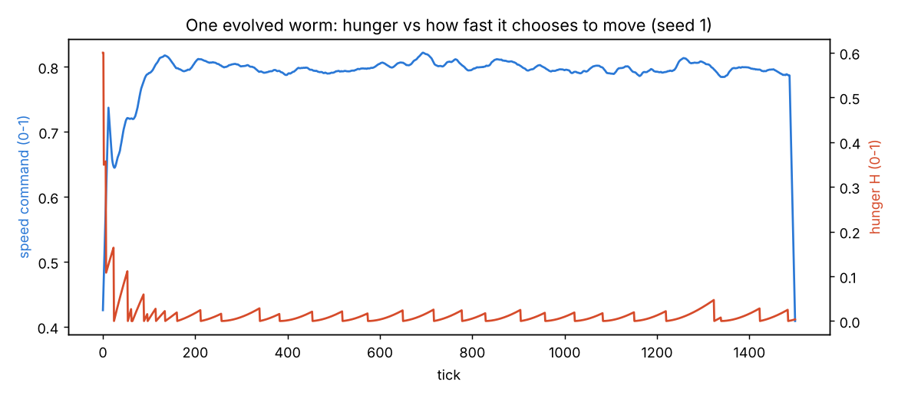
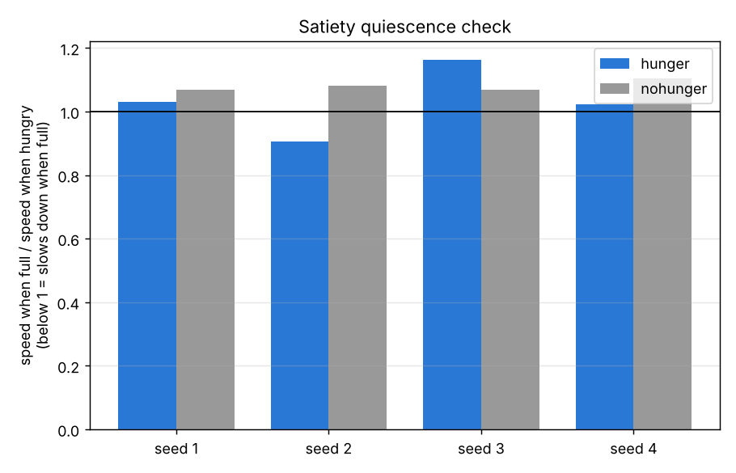
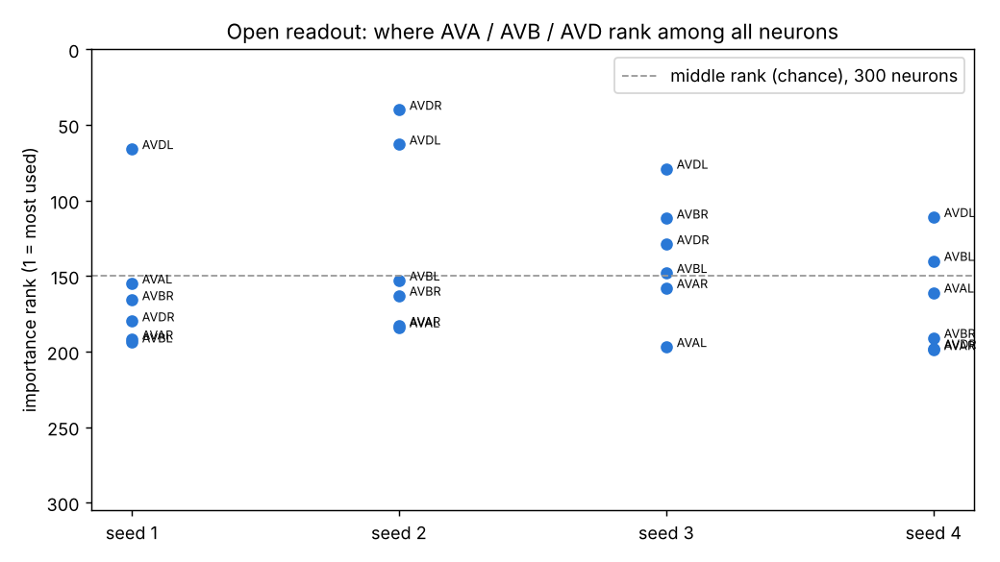
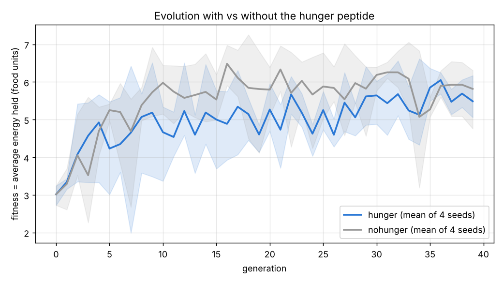
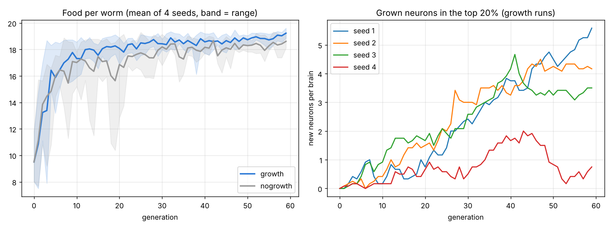
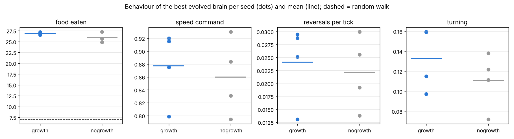
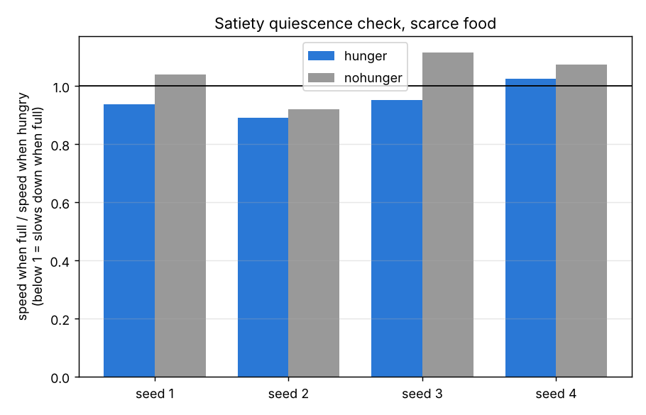

# Ecosystem-Evolved — Work Report (Oct 31, 2026, 14:39 → 16:41)

Source: `python/PROGRESS.md` and the git log. 15 commits.

## Bottom line

- A **real C. elegans brain** (300 neurons, 4,562 synapses) now drives cells in your sim, and evolution tunes it.
- Evolved worm brain finds **4.4× more food** than random movement. The tiny hand-built brain only managed 1.7×.
- Under food scarcity, **evolved brains survive; random brains go extinct.**
- The evolved brain is **highly redundant**: no single synapse or neuron matters. Performance comes from many small, spread-out changes, the same as in real worms.

## What was built

| Piece | File | What it does |
|---|---|---|
| Bacteria brain (Step 1) | `ecosim/evolve.py` | 4-input recurrent net, run-and-tumble movement, body rules ported from `Cell.java` |
| Worm brain (Step 2) | `ecosim/connectome.py` | Loads the Cook 2019 wiring (OpenWorm c302 data); smell sensors in, AVA/AVB + head muscles out |
| Structural mutations | `ecosim/connectome.py` | Tweak, gain, silence, restore, flip a synapse; knock out a neuron. Every child logs its mutations |
| Ecosystem mode | `ecosim/ecosystem.py` | No generations: cells eat, split, mutate, die continuously |
| Family-tree analysis | `ecosim/lineage.py` | Which mutation types survivors kept vs lost |
| Direct mutation test | `ecosim/mutation_effects.py` | Mutate → test on same worlds → compare |
| Knockout map | `ecosim/knockout_map.py` | Switch off each of 295 neurons, one at a time |
| Visual tools | `brainviz.py`, `plot.py`, `replay.py` | Brain picture, rewiring GIF, progress chart, replay video. Run locally, no AI cost |

## Results

**Step 1 — bacteria brain:** food per cell 1.8 → 7.0 over 30 generations. Fair test: 10.3 vs 6.2 random (**1.7×**).

**Step 2 — worm brain:** food 8.0 → 19.0 over 40 generations; most of the gain in generations 0–5. Fair test: 26.8 vs 6.2 (**4.4×**).

**What evolution changed:**
- Mostly **pruning** (104 weakened + 43 silenced vs 37 strengthened + 7 flipped).
- The **"smell getting weaker" sensor evolved strongest** (×6.5 vs ×2.9). Real worms turn when odor drops.
- The motor readout **rediscovered real biology**: AVB → forward, AVD → slow/back up.

**Ecosystem runs (natural selection, no generations):**
- 150,000 ticks, 2,664 births, survivors ~64 generations deep. Every mutation type kept at roughly chance rate → single mutations are **near-neutral** (genetic drift dominates).
- Scarcity: random-brain founders extinct by ~tick 2,100. Evolved-brain founders survived all 150,000 ticks, **in 4 of 4 seeds**.
- An early "silencing gets weeded out" hint **did not replicate** across seeds. Dropped.

**Robustness tests:**
- Single mutations: every type averages within ±0.15 food of no change (noise is ±2.4). Term: **mutational robustness**.
- Neuron knockouts: after fixing a crowding bug in the test, **no single neuron changes performance**, not even command neurons AVA/AVB. Their left/right partners cover for them.

## Bug found and fixed

The knockout map first showed big "gains" from removing VD neurons. Cause: the last test batch had fewer worms, so less competition for food. Fixed by padding every batch to equal size.

## Lessons

- Mixed-population quick tests are too noisy to rank single changes. Confirm with the fair test (same worlds, same crowding).
- To find mutation-level effects you need bigger mutations (a whole neuron's outputs, several synapses) or many more test runs.

## Logical next steps (not started)

1. Larger mutations: duplicate/delete whole neurons (neuroevolution of structure).
2. Internal states (hunger, fatigue) as brain inputs.
3. Swap in the fruit fly connectome (FlyWire / MaleCNS) once the worm pipeline is settled. Needs the RTX 2080.

---

# Addendum — Step 3 (Oct 31 evening)

Two questions, both answered **no**. Details and numbers: `python/PROGRESS.md` (Step 3).

1. **Hunger peptide:** no benefit and no satiety quiescence over 4 seeds. Food was too plentiful, so worms were
   almost never hungry and the signal had nothing to teach. Next test: scarcer food.
2. **Open readout:** evolution skipped the command neurons (AVA/AVB/AVD) and read the smell sensors and first relay
   neurons (ASE, AWC, AWA, AIY, AIZ) directly. The Step 2 "rediscovered AVB" claim depended on the hand-picked readout.

---

# Addendum — Step 3b and Step 4 (Oct 31, 19:17–19:37)

- **Step 3b: hunger peptide with scarce food** (4 seeds, fair test, fitness = average energy held):
  hunger 5.42 / 5.60 / 5.66 / 5.61 (mean **5.57**) vs no hunger 4.90 / 5.35 / 5.52 / 5.65 (mean **5.36**). Random walk 2.43.
  - Hunger came out ahead in 3 of 4 seeds, with a mean gain of about 4%: a **weak hint, not a confirmed result**.
  - Slowing down when full (speed full ÷ hungry < 1): 3 of 4 hunger seeds (0.94, 0.89, 0.95, 1.03) vs 1 of 4 without hunger (1.04, 0.92, 1.12, 1.07). This is the same direction as real worms' satiety quiescence, but small.
  - Scarcity made the signal start to matter. (Correction: with plentiful food the population was hungry ~30% of the time, not "never"; that came from one long-lived worm.)
- **Step 4: brain growth** (`ecosim/worm3.py`, `ecosim/step4.py`; 60 generations, 4 seeds): neuron duplication, blank new neurons, new synapses.
  - Brains grew 3.5–5.6 new neurons (top 20%) in 3 seeds, 0.75 in seed 4; best final brains had 0–5 new neurons and 8–16 new synapses. No shared pattern in which neurons were copied.
  - Every growth type reached the top 20% at ~0.2 of attempts = chance rate. **Growth is neutral; it accumulates by drift.**
  - Food: growth 26.9 vs no growth 25.9 (3 of 4 seeds ahead), but the gap opened by generation ~4–10, before any neurons had grown, so it is probably seed luck. No consistent change in speed, reversals or turning.
  - Growth only has a reason to matter once the world offers a new job (new senses, a predator).

## Still open
- Confirm the hunger hint with more seeds.
- Give growth a job: evolvable senses, then a predator (based on *Pristionchus pacificus*).
- Fruit-fly larva / adult connectome (needs the wiring data, and the RTX 2080 for the adult fly).
