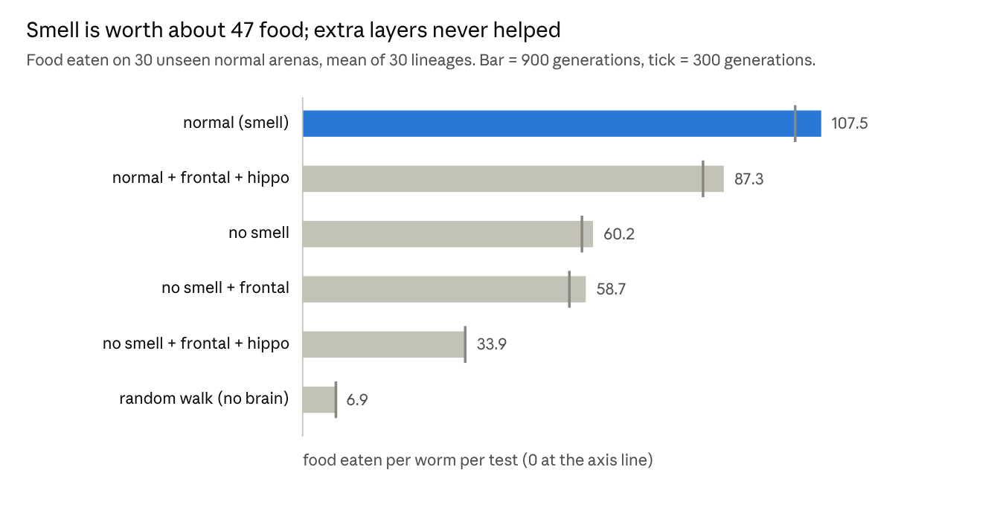

# Ecosystem-Evolved: Findings Book

*Copy of the Claude Doc "Ecosystem-Evolved: Findings Book", exported 13 November 2026 21:45 MT. The Doc is the working copy; this file is refreshed from it when it changes.*

## Title page

**ECOSYSTEM-EVOLVED**

**What evolution does to simulated worm brains, and what the world has to do to make it happen**

A research notebook in book form: every finding so far, the bugs that were found and fixed, and the words needed to read it.

|  |  |
| --- | --- |
| Project | Ecosystem-Evolved (github.com/tagwag/Ecosystem-Evolved) |
| Owner | Tag (tagwag) |
| Written by | Claude, from the project notes, status board and result files |
| Edition | 1st edition, 13 November 2026 |
| Covers | 1 November to 13 November 2026 (Steps 1-19, sweep, teacher, Main Experiment, equilibrium world, factor engine) |
| Hardware | Desktop: i9-10900K, 32 GB RAM, RTX 3080 (10 GB) |

How honest this book is: every number below comes from a saved results file or the project notes. Null results (no effect found) are reported as plainly as positive ones. A result is called confirmed only if it passed a rule written down before the run.

## Table of contents

1. How to read this book, and the big picture
2. Main Experiment (13 Nov) and Part I: the connectome platform (1 to 12 November)
   1. Steps 1-2: evolved brains beat random
   2. Steps 3-8: the hunger peptide becomes an off switch
   3. Steps 4-6: added brain features stay neutral
   4. Steps 10-19: the decline, the plateau and matched scoring
   5. Sweep screen1 and the teacher
3. Part II: the 2nd Experiment (toy brain)
   1. Smell, frontal and hippocampus layers
   2. Longer runs and the head-start test
   3. Interbreeding and the 7pm runs (in progress)
4. Part III: the equilibrium world
   1. The 50,000-tick test
   2. World 19 replayed and run for 600 generations
5. Part IV: the factor engine (38 factors)
6. Bugs found and fixed, open questions
7. Glossary
8. Thesaurus: everyday words and their scientific terms
9. Index
10. Sources

## 1. How to read this book, and the big picture

The big finding so far: evolution in these worlds quickly finds a good-enough brain and then stalls. New brain parts are useless unless the world gives them a job. One family of worms takes over within a few hundred generations, so variety collapses. Even a calm, food-rich world selects for thrift: worms evolve to move slower and waste less.

How each chapter is laid out:

- **Question**: what the run was meant to answer.
- **Rule set before the run**: what would count as a yes.
- **Result**: the numbers, with p-values. p < 0.05 means a result this big would turn up by luck less than 1 time in 20.
- **Verdict**: confirmed, hint, null (no effect) or flawed.

The four platforms, oldest first:

| Platform | Folder | What it is | Status |
| --- | --- | --- | --- |
| Connectome platform | python/ecosim | Real C. elegans wiring (300 neurons, 4,562 synapses) in a 2D food world | Archived as v1-baseline, results kept |
| 2nd Experiment (toy brain) | python/toybrain | Small evolvable brains (smell, frontal, hippocampus layers), 30 lineages on the GPU | Active, 3 runs until 7pm today |
| Equilibrium world | python/equilibrium | A world built to hold a steady population, with frozen / shadow / real arms | Active |
| Factor engine | python/engine | 38 environmental factors as off / auto / custom settings in a config form | Active, batch v3 + 9 explorations queued |

Words in **bold** on first use are in the Glossary (chapter 7). Everyday words are matched to their scientific terms in the Thesaurus (chapter 8).

## Main Experiment: a more realistic connectome worm (13 November, finished 19:00)

From 15:50 on 13 November the Main Experiment is the real C. elegans connectome brain with two realism upgrades. The toy brain is now the 2nd Experiment (Part II).

- **Reversal potentials:** each synapse pushes its target neuron toward a fixed voltage (+1 excitatory, -1 inhibitory), so excitation weakens as a neuron fills up. Before, current was just weight x activity.
- **Muscle output:** movement comes from the 95 body-wall muscles (speed), AVA vs AVB command neurons (reversals), and dorsal vs ventral head muscles (steering). Before, an evolved decoder read 28 interneurons and skipped the motor circuit.

Design: a 2 x 2 of old / + reversal / + muscles / both, 16 paired seeds, Step 19 world and scoring, all 4 arms run at once until 19:00. Rule set before the run: a feature helps or hurts if its main effect on skill (12 unseen worlds) differs from zero with Holm p < 0.05, compared at the last generation all arms reached.

| Arm (at 18:25) | Generations so far | Training fitness |
| --- | --- | --- |
| old model | 203 | 2.42 |
| + reversal potentials | 154 | 2.54 |
| + muscle output | 202 | 2.02 |
| both | 153 | 1.88 |

Early read, not the test: reversal potentials are level with the old model at fewer generations; muscle output starts weaker (the muscle pathway begins with little drive and has to be strengthened by evolution). The yardstick test runs right after 19:00. Full method: python/ecosim/STEP20\_MAIN\_EXPERIMENT.md.

### Result (19:13, by the rule set before the run)

Muscle output hurt, and reversal potentials made no detectable difference. All arms were compared at generation 190, on 12 unseen worlds, 16 paired seeds.

| Arm | Skill | Food | Bites |
| --- | --- | --- | --- |
| old model | 2.652 | 7.60 | 1.22 |
| + reversal potentials | 2.791 | 7.52 | 1.22 |
| + muscle output | 2.164 | 7.06 | 0.82 |
| both | 2.019 | 7.05 | 0.77 |

- **Reversal potentials: no detectable effect.** Main effect -0.003, positive in 8 of 16 seeds, Holm p = 0.97.
- **Muscle output: hurts at this length.** Main effect -0.630, positive in 0 of 16 seeds, Holm p = 0.0001.
- Interaction -0.28 (p = 0.028, secondary): reversal potentials look slightly good with the decoder (+0.14) and slightly bad with muscles (-0.15).
- Muscle-output worms were bitten less and ate less. They move less; they are not smarter.

What this does and does not show: it does not show real muscles are worse than a decoder. This muscle readout gives evolution 3 gains to tune, against 168 decoder weights, and the muscle pathway starts with very little drive. About 190 generations was not enough to build it. Worth testing next: longer runs, stronger starting muscle synapses, and a body model where alternating dorsal and ventral activation produces thrust.

## 2. Part I: the connectome platform (1 to 12 November)

Evolution tuned the real worm wiring to forage 4.4 times better than a random walk, but almost every brain feature added on top did nothing. The world never demanded them. Brain: Cook 2019 connectome via OpenWorm c302, one strength gene per synapse. Fair test: one genome copied to 40 worms on unseen worlds.

### 2.1 Steps 1-2: evolved brains beat random

| Step | Result | Verdict |
| --- | --- | --- |
| 1 Tiny evolved brain | 1.7x a random walk | Confirmed |
| 2 Worm connectome | 4.4x a random walk; evolution mostly prunes; no single neuron or synapse matters (redundancy) | Confirmed |
| 3 Open readout | Evolution reads smell sensors and first relays (ASE, AWC, AWA, AIY, AIZ) and skips command neurons AVA/AVB | Weakens the earlier "rediscovered AVB" claim |

### 2.2 Steps 3-8: the hunger peptide becomes an off switch

The hunger peptide (a broadcast signal each neuron can evolve a receptor for) reliably became a way to switch movement off. It never became a clear fitness gain.

| Step | Seeds | Result | Verdict |
| --- | --- | --- | --- |
| 3c | 12 | Energy p=0.64, slowing when full p=0.33 | Null |
| 3d | 32 | Slows when full (speed 0.98 vs 1.05, p=0.0004) but holds less energy (3.84 vs 4.08, p=0.006) | Confirmed, but it costs fitness |
| 3e | 32 | At high move costs peptide brains "win" by sitting still and starving slowly | Reward hacking: the fitness rule was flawed |
| 3e2 | 32 | Fixed fitness rule: +0.24 at cost 0.5 (p=0.036, not significant after correction) | Hint |
| 3f / 13b | 32 | Starvation alarm into ASH: null; peptide hurts when the alarm is on (-0.25, p=0.0085) | Mostly null |
| 8c | 32 | With digestion while still, 2/3 of peptide seeds freeze (eat nothing) | Peptide harmful: a local-optimum trap |
| 12 | 32 | Under clonal scoring the freeze trap disappears; peptide neutral to harmful | Null |
| 14a | 32 | Knocking the peptide out costs -0.70, but brains recover within 10 generations | Entrenched, not baggage |

### 2.3 Steps 4-6: added brain features stay neutral

| Step | Feature | Result | Verdict |
| --- | --- | --- | --- |
| 4, 4g, 13c | Brain growth (new neurons and synapses) | Food 18.63 vs 18.63 (p=0.99); brains grew 1-10 neurons by drift | Null |
| 5 | Lifetime learning (Hebb, dopamine, curiosity, sleep) | No learner beat the fixed brain (18.8); evolution turned learning rates down | Null: the task never needed learning |
| 6 / 6b | Curriculum and memory | Hint at 4 seeds (p=0.08) gone at 12 seeds (p=0.98) | Null (was noise) |
| 7 | Seeded random numbers vs OS entropy | All p >= 0.15 | No difference |

### 2.4 Steps 10-19: the decline, the plateau and matched scoring

| Step | Result |
| --- | --- |
| 10 | The late fitness decline was a **tragedy of the commons**: evolution picked food-competitive brains that did worse as a group (late beat early head-to-head 30/32, but alone were worse 29/32). Fixed with clonal-group scoring. |
| 8 / 13a | Predators cost a lot (-1.15, p<0.0001); touch gave no escape (+0.14, p=0.12) |
| 14b | Selfish-herd predators gave weak clumping (-3.5 distance vs plain, p=0.051) |
| 15 | One lineage takes over in a median of 7 generations; champions plateau near 3.2, below the best founder |
| 16-18 | New worlds did not break the plateau; skill fell in every arm, the control too. Likely cause: small training worlds vs full-size test worlds. Rocks gave no hiding. |
| 19 | With matched scoring (full-size worlds) skill keeps climbing slowly: 2.54 to 3.33 over 300 generations, still rising |

### 2.5 Sweep screen1 and the teacher

- **Sweep screen1** (16 arms x 8 seeds x 100 generations): no factor raised general skill. Harder worlds lowered it (all senses -0.52, digestion -0.47, scarce food -0.26). Design flaw: with 8 seeds the test's smallest possible corrected p was 0.0625, so the rule (p < 0.05) could never pass.
- **Progress-chasing teacher** (curriculum that picks worlds by learning progress): lost to a single fixed world on intelligence, 2.94 vs 2.46 (p=0.008). It was no better than random rotation (p=0.6). Its progress signal mostly measured recovery from its own world switches.
- On 12 November the owner decided to restart with better measurement. Everything up to here is kept as git branch v1-baseline.

## 3. Part II: the 2nd Experiment (toy brain; called Main Experiment 15:10-15:50 on 13 Nov)

Smell is by far the most valuable sense. Adding frontal or hippocampus layers never helped. Every run plateaus within about 300 generations. The Main Experiment evolves 5 brain types at once on the RTX 3080: 30 independent **lineages** each, 48 worms per lineage, 8 **elites** kept per generation. Each lineage's best brain is then scored on 30 fresh arenas it never saw (the **fair test**).

### 3.1 Smell, frontal and hippocampus layers

*Source: toybrain/results_gpu_300g_30s_fair.json and results_gpu_900g_30s_fair.json, fair mode, 30 lineages each.*

- **Fair mode matters.** In the first run, mutation size was per gene, so big brains (6x more genes) got about 2.5x larger mutations. The frontal layer looked harmful (-16.7 food). With mutation scaled by genome size (fair mode), frontal is level with no-smell (55.3 vs 57.9, p=0.3).
- **Hippocampus still hurts** after the fix: -21.6 food (p=8e-13) without smell, -19.1 (p=3e-12) with smell. Its neurons start off and switch on during life, so they mostly add noise.
- **Sparse arenas** (2 food patches) give the same ranking at about half the food.

### 3.2 Longer runs and the head-start test

Question: does continuing the 300-generation champions for 600 more generations beat starting fresh and running 900? Rule set before: the continuation must be higher, Welch p < 0.05.

| Brain type | Fresh 900 gens | 300 + 600 continued | p | Mutations on the best brain (fresh, median) |
| --- | --- | --- | --- | --- |
| normal | 107.5 | 104.6 | 0.031 (fresh better) | 554 |
| no smell | 60.2 | 59.8 | 0.87 | 660 |
| no smell + frontal | 58.7 | 57.6 | 0.65 | 636 |
| no smell + frontal + hippo | 33.9 | 33.0 | 0.57 | 720 |
| normal + frontal + hippo | 87.3 | 86.4 | 0.61 | 596 |

Verdict: **head start not supported.** Fresh runs were equal or better. Slopes over the last 100 generations were 0 to 1 food per 100 generations: a plateau.

Why it stalls: the **reproductive share** of the winning ancestor is 1.00 in every lineage. One founder's family takes over the whole population, so there is no variety left to select from. This also makes the owner's **combined score** (share x fair score) equal to the plain fair score here.

Best single lineages so far: normal #24 (116.2 food, 377 mutations on its line) and normal+frontal+hippo #12 (97.2, 373 mutations), from the continuation run.

### 3.3 Interbreeding and the 7pm runs (in progress)

To keep variety, 25% of each lineage's children are now crosses: each gene comes 50/50 from its own elite parent or from an elite of another lineage. Three runs started 13 November at 15:21, all 3,200 generations (about 1.5 generations a second, so done near 18:20), same seeds, with a hard stop at 19:00:

| Run | Interbreeding | Independent replicates |
| --- | --- | --- |
| m1 reference | none | 30 lineages |
| m2 one pool | any lineage with any other | 1 (all lineages share genes) |
| m3 10 groups | only inside groups of 3 | 10 groups |

Rule set before (13 November): interbreeding helps if m3's 10 group means beat m1's lineages grouped the same way (Welch p < 0.05). m2 can only be judged by its level and its kept variety, since its lineages are not independent. Results will be added here.

## 4. Part III: the equilibrium world

A world built to hold a steady population still produces real adaptation. Over 600 generations, worms under natural selection became 3x slower than unevolved ones and ate 1.8x more per tick than chance-only worms. The world is 400 x 400 units with 80 food patches. Each run has three **arms** with identical starting worms:

- **Frozen**: no mutation. It checks the code: genetic distance must stay at exactly 0, and population must stay steady.
- **Shadow** (neutral shadow, Bedau & Packard): births and deaths copy the real arm's counts, but who dies is picked at random. It shows what chance alone does.
- **Real**: natural selection. **Adaptation = real minus shadow.**

### 4.1 The 50,000-tick test (30 worlds)

Rules set before: zero point (frozen genetic distance = 0) and equilibrium (every frozen world within ±10% of its mean over the last 75% of the run).

| Measure (end of run) | Frozen | Shadow | Real | Real vs shadow |
| --- | --- | --- | --- | --- |
| Population | 384.9 | 482.5 | 482.5 | equal by design |
| Genetic distance from founder | 0 | 4.95 | 5.56 | +0.62, 29/30, p=5e-05 |
| Eating rate (food per worm per tick) | 0.0389 | 0.0310 | 0.0336 | +0.0026, 30/30, p=5e-05 |
| Speed | 0.94 | 0.87 | 0.60 | -0.27, 1/30, p=5e-05 |
| Founder lineages alive | 20.8 | 22.1 | 44.4 | +22.3, 30/30, p=5e-05 |

- Zero point: **PASS** (maximum distance 0).
- Equilibrium: **FAIL, narrowly.** 29 of 30 worlds stayed within 10%; world 19 dipped 12.6% at tick 13,000 (median swing 4.7%).

### 4.2 World 19 replayed and run for 600 generations

The exact replay reproduced world 19 (frozen population 336 at tick 13,000, as before). From that moment, 10 copies ran on for 1.6 million ticks, about 600 generations.

| Measure (tick 1,613,000, mean of 10 copies) | Frozen | Shadow | Real | Real vs shadow |
| --- | --- | --- | --- | --- |
| Population | 384 | 566 | 566 | equal by design |
| Worst swing from mean (last 75%) | 3.8-5.5% | 3.8-7.1% | 3.8-7.1% |  |
| Genetic distance from founder | 0 | 20.0 | 25.0 | +5.1, 10/10, p=3.5e-09 |
| Eating rate | 0.042 | 0.016 | 0.028 | +0.012, 10/10, p=2.5e-05 |
| Speed | 1.00 | 0.79 | 0.31 | -0.48, 0/10, p=4.7e-06 |
| Family lines still alive | 47.1 | 2.0 | 36.3 | +34.3, 10/10, p=1.1e-07 |
| Mutations on a living worm's line (mean) | 0 | 314 | 486 |  |
| Share held by the biggest family | 6% | 79% | 19% |  |

- Equilibrium over 600 generations: **PASS for world 19** (every frozen copy within ±5.5%). The 12.6% dip was a one-off.
- The thrift result **grew stronger with time**: real worms slowed from 0.60 (50k ticks) to 0.31, and the population they support rose from 483 to 566.
- Surprise: chance alone (shadow) lets one family take 79% of the world. Selection (real) keeps 36 family lines alive, because many families find the same thrifty answer.
- Caveat: shadow worms can hold negative energy (mean -103), because shadow deaths are random, not from starvation. Compare shadow on genes and family structure, not energy.

## 5. Part IV: the factor engine (38 factors)

The first clean factor results (5.1) show the same thrift adaptation in every world tested, and no evolved use of the pain signal yet. The first batch was contaminated by a bug; the clean rerun (batch v3) is still running. The engine puts the equilibrium world behind an experiment form. Each of 38 environmental factors can be **off**, **auto** (realistic values from the research) or **custom**. Every setting has a footnote into FACTOR\_GUIDE.md with its sources.

| Category | Factors |
| --- | --- |
| Physical | temperature, oxygen, carbon dioxide, humidity, osmolarity, pH, substrate, light, mechanical, electric field, magnetic field (contested), gravity, radiofrequency (untested) |
| Radiation | radiation, chemical mutagens |
| Food | amount, layout, quality, digestion, microbiome |
| Biological | pathogenic bacteria, virus, microsporidia, fungal parasites, predatory fungi, predators, competitors, carriers |
| Population | density, boom-bust, size, mating system, migration |
| Genetic | mutation rate, extra inheritance |
| Chemical, meta, internal | toxins, variability, starvation signal |

Evidence tags: EVO = shown to drive evolution in real worms; EFFECT = changes fitness or behaviour; CONTESTED = disputed; UNTESTED = no C. elegans study found.

**Batch v1 (archived, do not use):** the mutation-rate gene drifted even with its factor off, and the baseline used different founders. Archived in engine/results/old\_mutbug/. One result held in every world even so: real worms evolved to move slower than shadow worms.

**Running and queued (13 November):**

| Job | Form | Question |
| --- | --- | --- |
| f1-f6 | baseline, ASH pain, Pristionchus, virus HGT, evolvable mutation rate, temperature | Engine batch v3: does each factor change evolution vs the baseline? |
| x1-x2 | magnetic field, radiofrequency | Contested and untested factors: would they matter? (Radiofrequency runs with an assumed weak cost, since its autopilot is "no effect"; gravity at Mars-like 0.38 g.) |
| x3-x9 | radiation, gravity, electric field, predatory fungi, microsporidia, mating system, migration | Newly built factors on autopilot vs baseline |

Each form runs 30 worlds x 3 arms (frozen / shadow / real) for 50,000 ticks, about 8 minutes on the GPU. Results will be added here.

### 5.1 First clean results (batch v3, 13 November 15:14)

The clean baseline passes both rules: zero point (distance 0) and equilibrium (worst frozen swing 8.8%, under 10%). In both worlds below, selection made worms slower and better at eating than chance did, and it shed costly abilities they never needed.

| Real minus shadow (30 worlds, sign-flip test) | Baseline (no factors) | ASH pain world (half food + cadmium + starvation alarm) |
| --- | --- | --- |
| Population (frozen / real) | 385 / 426 | 190 / 198 |
| Eating rate | +0.0031, 30/30, p=5e-05 | +0.0118, 30/30, p=5e-05 |
| Speed | -0.20, p=5e-05 | -0.10, p=0.0006 |
| Family lines alive | +25.0, 29/30 | +29.4, 30/30 |
| Genetic distance from founder | +0.36, 24/30 | -0.53, 2/30 (real changed LESS than chance) |
| Toxin resistance trait | -0.08 (dropped: it costs energy) | -0.03 (dropped less: cadmium present) |

- **No pain-signal use evolved.** In the ASH pain world, real worms' wiring to the nociception and toxin senses (0.30) was not stronger than chance (0.32-0.33). The alarm was present but evolution did not tie behaviour to it in 50,000 ticks.
- **Scarce food makes selection conservative.** Real worms stayed closer to their founders than chance would put them (p=5e-05). Many changes were harmful, so selection removed them.
- Caveat: one run per world, 50,000 ticks (about 18 worm generations). Longer runs are needed before calling the pain result a null.

## 6. Bugs found and fixed, open questions

Nine flaws have changed results so far. Each was fixed, and the affected results were archived, not deleted.

| Date | Flaw | Effect on results | Fix |
| --- | --- | --- | --- |
| 13 Nov | Engine mutation-rate gene drifted with its factor off; baseline had other founders | Engine batch v1 unusable | Gene locked, founders matched, batch v3 rerun |
| 13 Nov | Main Experiment mutation size per gene, not per genome | Big brains looked worse than they are | Fair mode: mutation x sqrt(130 / genes), start size by brain size |
| 13 Nov | Equilibrium shadow arm did not truly copy real birth/death counts | Early equilibrium runs crashed or drifted | True neutral shadow; bigger world (400², 80 patches) |
| 12 Nov | Sweep screen1 used 8 seeds | The pass rule could never be met (smallest corrected p 0.0625) | Use 16 or more seeds |
| 8 Nov | Training in small worlds, testing in full-size ones | Fake decline and plateau (Steps 16-17) | Matched scoring (Step 19) |
| 9 Nov | Teacher's progress signal measured recovery from its own switches | Teacher chased harmful worlds | Open: measure progress on a fixed check |
| 2 Nov | Fitness = average energy held | Reward hacking: brains sat still and starved slowly (Step 3e) | Energy at end + survival |
| 1 Nov | Learning could only strengthen synapses | All learners saturated (Step 5) | Covariance Hebb, dopamine as prediction error; reruns |
| 1 Nov | Elites ate first on food ties | Slight tilt toward parents in Steps 1-4 | Random eating order each tick |

**Open questions**

- Does interbreeding keep variety and break the Main Experiment plateau? (m1-m3, tonight)
- Which of the 38 factors change evolution in the equilibrium world? (batch v3 + explorations)
- Does an environment ever make a new brain part worth having? So far: no.
- Why does selection keep many families alive (36) while chance lets one take over (79%)?

## 7. Glossary

| Term | Meaning in this project |
| --- | --- |
| Adaptation | Real arm minus shadow arm: the change caused by selection rather than chance |
| Arm | One version of a world run side by side with others (frozen, shadow, real; or brain types) |
| Carrying capacity | The population a world's food can support; set by food regrowth |
| Checkpoint | A saved copy of a whole run at one moment; used to resume or branch |
| Clonal-group scoring | Scoring a brain by copying it into a group of identical worms, so selfish brains can't win at the group's expense |
| Combined score | Owner's definition of best: reproductive share x fair-test score; tie-break = recent slope |
| Connectome | The full wiring diagram of a nervous system (here C. elegans: 300 neurons) |
| Crossover (interbreeding) | A child's genes taken partly from one parent and partly from another |
| Drift (genetic drift) | Change in a population caused by chance, not by fitness |
| Elite | One of the best worms of a generation, copied unchanged into the next |
| Equilibrium | A steady state: births balance deaths and population stays level |
| Fair test | Scoring a finished brain on fresh, unseen worlds, the same for every condition |
| Fixation | When one gene version or family reaches 100% of a population |
| Founder | A worm placed in the world at the start; its descendants form a family line |
| Frozen arm | Control arm with no mutation; must show zero genetic change |
| Generation | One round of selection and reproduction (Main Experiment), or about one worm lifetime (equilibrium, about 2,700 ticks) |
| Genetic distance | How far a worm's genes have moved from its founder's |
| Holm correction | A fix to p-values when several tests are run at once, so luck isn't counted as a find |
| Lineage | A family line descended from one founder, or (Main Experiment) one independent evolving population |
| MRCA | Most recent common ancestor of a set of worms |
| Mutation | A random change to a gene when a child is made |
| Neutral shadow | The shadow arm: same birth and death counts as the real arm, but random survivors (Bedau & Packard) |
| Null result | No effect found; reported as plainly as a positive one |
| p-value | Chance of seeing an effect this big if nothing is really going on; < 0.05 = significant here |
| Plateau | When skill stops rising over generations |
| Pre-registration | Writing down the success rule before seeing results |
| Replicate | An independent copy of a run with different luck (seed) |
| Reproductive share | Fraction of the final population descended from the winner's ancestor |
| Reward hacking | Evolution scoring well by exploiting a flaw in the scoring rule rather than doing the task |
| Seed | The number that fixes a run's random choices; same seed = same run |
| Tick | One time step: every worm senses, thinks and moves once |
| Tragedy of the commons | Individuals winning by competing, while the group as a whole does worse |
| Welch t-test | A test of whether two groups' averages differ, allowing different spreads |

## 8. Thesaurus: everyday words and their scientific terms

Left: words used in conversation. Right: the term a paper would use, and related terms.

| Everyday words | Scientific term | Related terms |
| --- | --- | --- |
| perfect world, steady world | equilibrium environment | carrying capacity, steady state, stationary population |
| no-evolution control | frozen arm | negative control, zero point |
| luck-only version | neutral shadow model | null model, genetic drift |
| interbreeding, mixing lineages | recombination, crossover | gene flow, outcrossing, island model |
| independent groups | demes, subpopulations | island model, replicate populations |
| family tree | genealogy, phylogeny | coalescent, lineage tracing |
| one family takes over | fixation, selective sweep | loss of diversity, bottleneck |
| variety | genetic diversity, standing variation | heterozygosity, gene variance |
| best worm, champion | fittest individual, elite | top genotype |
| how well it does | fitness | reproductive success, performance |
| test on new worlds | out-of-sample test, generalization test | held-out evaluation |
| stuck, stops improving | fitness plateau, local optimum | adaptive peak, stasis |
| replay from a point | replay experiment (Lenski) | historical contingency |
| head start | pre-adaptation, continued evolution | warm start |
| slower, saves energy | thrift, energy-efficient foraging | life-history trade-off |
| cheating the score | reward hacking, specification gaming | Goodhart's law |
| freeze trap | local optimum, evolutionary trap | deceptive fitness landscape |
| hunger chemical | neuropeptide, neuromodulator | satiety signal |
| pain sensor | nociceptor (ASH neuron) | aversive sensing |
| brain layers | neural architecture | network depth, modules |
| worm wiring map | connectome | neural circuit |
| random walk worm | random baseline | null forager |
| copy of a run with different luck | replicate, seed | independent sample |
| settings file | configuration, experimental protocol | parameter sweep |
| autopilot | default parameterization | literature-based defaults |
| weird or disputed factor | contested evidence, untested factor | fringe hypothesis |
| the GPU fills up | resource utilization | throughput, concurrency |

## 9. Index

| Topic | Where |
| --- | --- |
| Adaptation (real minus shadow) | 4, 4.1, 4.2, 7 |
| Alarm, starvation (ASH) | 2.2 |
| Batch v1 contamination | 5, 6 |
| Combined score | 3.2, 7 |
| Connectome | 2, 7, 8 |
| Curriculum / teacher | 2.3, 2.5, 6 |
| Equilibrium rule | 4.1, 4.2 |
| Factor engine, 38 factors | 5 |
| Fair mode (mutation scaling) | 3.1, 6 |
| Frontal layer | 3.1 |
| Frozen arm | 4, 7 |
| Growth, brain | 2.3 |
| Head-start test | 3.2 |
| Hippocampus layer | 3.1 |
| Interbreeding (m1-m3) | 3.3, 6 |
| Learning, lifetime | 2.3, 6 |
| Magnetic field, radiofrequency | 5 |
| Matched scoring | 2.4, 6 |
| Memory | 2.3 |
| Peptide, hunger | 2.2 |
| Plateau | 2.4, 3.2 |
| Predators | 2.4 |
| Reward hacking | 2.2, 6, 8 |
| Shadow arm | 4, 7 |
| Smell | 3.1 |
| Sweep screen1 | 2.5, 6 |
| Thrift (slower, more efficient worms) | 4.1, 4.2 |
| Tragedy of the commons | 2.4, 7 |
| World 19 | 4.1, 4.2 |

## 10. Sources

- Cook S.J. et al. (2019). Whole-animal connectomes of both C. elegans sexes. Nature 571. [doi:10.1038/s41586-019-1352-7](https://doi.org/10.1038/s41586-019-1352-7)
- OpenWorm c302 (connectome model framework). [github.com/openworm/c302](https://github.com/openworm/c302)
- Bedau M.A. & Packard N.H. (1992). Measurement of evolutionary activity, teleology, and life. Artificial Life II. (Source of the neutral shadow method.)
- Lenski R.E. et al. (1991). Long-term experimental evolution in E. coli. American Naturalist 138. (Replay experiments.)
- Ghosh D.D. et al. (2016). Neural architecture of hunger-dependent multisensory decision making in C. elegans. Neuron 92. (Hunger overrides aversion.)
- Factor research: 38 sources listed in python/factors/sources.md and per factor in python/engine/FACTOR\_GUIDE.md.
- Project data: PROJECT\_NOTES.txt, STATUS.md, toybrain/results\_gpu\_*\_fair.json, equilibrium/results/eq\_50000t\_30s*.json and eq\_w19\_1613000t\_10s.json.
