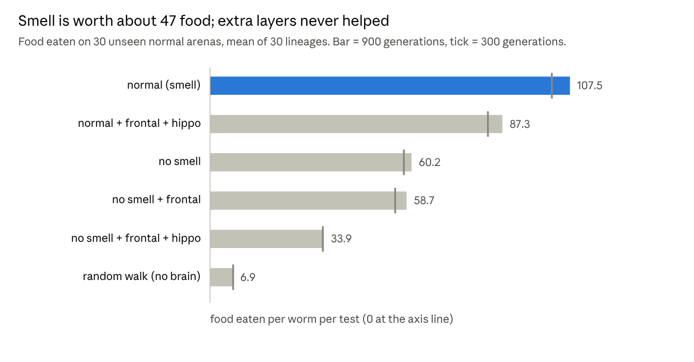

# Ecosystem-Evolved: Findings Book

Nov 13, 2026 · @tag

## Title page

**ECOSYSTEM-EVOLVED**

**What evolution does to simulated worm brains, and what the world has to do to make it happen**

A research notebook in book form: every finding so far, the bugs that were found and fixed, and the words needed to read it.

|  |  |
| --- | --- |
| Project | Ecosystem-Evolved (github.com/tagwag/Ecosystem-Evolved) |
| Owner | Tag (tagwag) |
| Written by | Claude, from the project notes, status board and result files |
| Edition | 1st edition, 13 November 2026; updated 23 November 2026 |
| Covers | 1 November to 13 November 2026 (Steps 1-19, sweep, teacher, Main Experiment, equilibrium world, factor engine) |
| Hardware | Desktop: i9-10900K, 32 GB RAM, RTX 3080 (10 GB) |

How honest this book is: every number below comes from a saved results file or the project notes. Null results (no effect found) are reported as plainly as positive ones. A result is called confirmed only if it passed a rule written down before the run.

## Table of contents

1. How to read this book, and the big picture
2. Main Experiment (13 Nov) and Part I: the connectome platform (1 to 12 November)
   1. Steps 1-2: evolved brains beat random
   2. Steps 3-8: the hunger peptide becomes an off switch
   3. Steps 4-6: added brain features stay neutral
   4. Steps 10-19: the decline, the plateau and matched scoring
   5. Sweep screen1 and the teacher
3. Part II: the 2nd Experiment (toy brain)
   1. Smell, frontal and hippocampus layers
   2. Longer runs and the head-start test
   3. Interbreeding: 3,200-generation runs (done)
4. Part III: the equilibrium world
   1. The 50,000-tick test
   2. World 19 replayed and run for 600 generations
5. Part IV: the factor engine (38 factors)
6. Bugs found and fixed, open questions
7. Glossary
8. Thesaurus: everyday words and their scientific terms
9. Index
10. Sources

## 1. How to read this book, and the big picture

The big finding so far: evolution in these worlds quickly finds a good-enough brain and then stalls. New brain parts are useless unless the world gives them a job. One family of worms takes over within a few hundred generations, so variety collapses. Even a calm, food-rich world selects for thrift: worms evolve to move slower and waste less.

How each chapter is laid out:

- **Question**: what the run was meant to answer.
- **Rule set before the run**: what would count as a yes.
- **Result**: the numbers, with p-values. p < 0.05 means a result this big would turn up by luck less than 1 time in 20.
- **Verdict**: confirmed, hint, null (no effect) or flawed.

The four platforms, oldest first:

| Platform | Folder | What it is | Status |
| --- | --- | --- | --- |
| Connectome platform | python/ecosim | Real C. elegans wiring (300 neurons, 4,562 synapses) in a 2D food world | Archived as v1-baseline, results kept |
| 2nd Experiment (toy brain) | python/toybrain | Small evolvable brains (smell, frontal, hippocampus layers), 30 lineages on the GPU | Done: the three 3,200-generation runs finished 13 November (section 3.3) |
| Equilibrium world | python/equilibrium | A world built to hold a steady population, with frozen / shadow / real arms | Active |
| Factor engine | python/engine | 38 environmental factors as off / auto / custom settings in a config form | Done: batch v3 and all 9 explorations finished 14 November (section 5.2) |

Words in **bold** on first use are in the Glossary (chapter 7). Everyday words are matched to their scientific terms in the Thesaurus (chapter 8).

## Main Experiment: a more realistic connectome worm (13 November, finished 19:00)

From 15:50 on 13 November the Main Experiment is the real C. elegans connectome brain with two realism upgrades. The toy brain is now the 2nd Experiment (Part II).

- **Reversal potentials:** each synapse pushes its target neuron toward a fixed voltage (+1 excitatory, -1 inhibitory), so excitation weakens as a neuron fills up. Before, current was just weight x activity.
- **Muscle output:** movement comes from the 95 body-wall muscles (speed), AVA vs AVB command neurons (reversals), and dorsal vs ventral head muscles (steering). Before, an evolved decoder read 28 interneurons and skipped the motor circuit.

Design: a 2 x 2 of old / + reversal / + muscles / both, 16 paired seeds, Step 19 world and scoring, all 4 arms run at once until 19:00. Rule set before the run: a feature helps or hurts if its main effect on skill (12 unseen worlds) differs from zero with Holm p < 0.05, compared at the last generation all arms reached.

| Arm (at 18:25) | Generations so far | Training fitness |
| --- | --- | --- |
| old model | 203 | 2.42 |
| + reversal potentials | 154 | 2.54 |
| + muscle output | 202 | 2.02 |
| both | 153 | 1.88 |

Early read, not the test: reversal potentials are level with the old model at fewer generations; muscle output starts weaker (the muscle pathway begins with little drive and has to be strengthened by evolution). The yardstick test runs right after 19:00. Full method: python/ecosim/STEP20\_MAIN\_EXPERIMENT.md.

### Result (19:13, by the rule set before the run)

Muscle output hurt, and reversal potentials made no detectable difference. All arms were compared at generation 190, on 12 unseen worlds, 16 paired seeds.

| Arm | Skill | Food | Bites |
| --- | --- | --- | --- |
| old model | 2.652 | 7.60 | 1.22 |
| + reversal potentials | 2.791 | 7.52 | 1.22 |
| + muscle output | 2.164 | 7.06 | 0.82 |
| both | 2.019 | 7.05 | 0.77 |

- **Reversal potentials: no detectable effect.** Main effect -0.003, positive in 8 of 16 seeds, Holm p = 0.97.
- **Muscle output: hurts at this length.** Main effect -0.630, positive in 0 of 16 seeds, Holm p = 0.0001.
- Interaction -0.28 (p = 0.028, secondary): reversal potentials look slightly good with the decoder (+0.14) and slightly bad with muscles (-0.15).
- Muscle-output worms were bitten less and ate less. They move less; they are not smarter.

What this does and does not show: it does not show real muscles are worse than a decoder. This muscle readout gives evolution 3 gains to tune, against 168 decoder weights, and the muscle pathway starts with very little drive. About 190 generations was not enough to build it. Worth testing next: longer runs, stronger starting muscle synapses, and a body model where alternating dorsal and ventral activation produces thrust.

## Reward Hacking experiment: red light / green light (14 November, finished 06:41)

The command was learned. Worms evolved to stop when the peptide signal says red and go when it says green, in all 16 seeds, without the sit-still cheat. Method: python/ecosim/STEP22\_REWARD\_HACKING\_EXPERIMENT.md.

| Arm (generation 300, unseen worlds, unseen timing) | Go/no-go index | Speed on green | Speed on red | Skill | Seeds that just sit still |
| --- | --- | --- | --- | --- | --- |
| true signal | +0.963 | 0.712 | 0.013 | 2.577 | 0 of 16 |
| scrambled signal | +0.191 | 0.374 | 0.256 | 1.186 | 0 of 16 |
| no signal (no receptors) | -0.065 | 0.408 | 0.466 | 1.359 | 0 of 16 |

- **Rule 1, command learned: YES.** Signal beats scrambled by +0.77 and no-signal by +1.03, each in 16 of 16 seeds (Holm p = 0.0001).
- **Rule 2, obedience: YES.** The same brains given a scrambled peptide drop from 0.96 to 0.26 (p = 0.00005). They follow the peptide, not another cue.
- **Rule 3, reward-hacking check: PASS.** No seed won by never moving.
- An honest signal doubled skill (2.58 vs 1.19 and 1.36).
- What it is: an evolved reflex to an outside broadcast signal. What it is not: learning within a lifetime, or a hunger signal (the peptide level was set from outside).
- Open oddity: the scrambled arm shows a small positive index (+0.19) although its signal carries no information. Not yet explained.

## Gravity experiment: 100 graded seeds (13-14 November, finished 04:05)

No effect found. Across a 1000-fold range of gravity pattern strength, evolved behaviour and skill did not change. Method: python/ecosim/STEP21\_GRAVITY\_EXPERIMENT.md.

- **Rule 1, behaviour:** avoidance of heavy ground (all brains tested at full strength) vs log strength evolved under: Spearman rho = +0.10, p = 0.33. No detectable trend.
- **Rule 2, cost of specialising:** skill with no gravity vs log strength: rho = +0.03, p = 0.73. No trend.
- Every tenth of the series sat slightly MORE on heavy ground than chance (avoidance -0.05 to -0.19). Worms move slower there, so they linger: the passive bias predicted before the run.
- Reading: with these rules (energy cost up to 0.3 per tick against 0.6 for living), gravity is invisible to selection within 300 generations. It does not show gravity cannot matter, only that this version did not.
- Decision that follows: a slowly changing ("eroding") gravity pattern was proposed on 14 November and held back at first, because worms ignored even a constant strong pattern. It was run on 16 November with the harsher rules (see "Eroding gravity, Step 29": no effect). A short test of harsher gravity rules (python/ecosim/step24.py) was run on 16 November: see "Gravity bite test, Step 24" below. Harsh, sensed gravity IS avoided.

## Can evolution here be predicted? (analysis of all saved runs, 14 November)

The average outcome of a condition can be predicted early; the fate of a single seed cannot. Data: 544 runs with per-generation histories (connectome Steps 19-22 and toy-brain runs), predicting each run's level at generation 190 from its first k generations. Every model was tested on an experiment family it had never seen.

| Generations seen | Typical error in a run's final level | Which condition ends higher (rank agreement, 1 = perfect) | Which seed ends higher inside a condition |
| --- | --- | --- | --- |
| 10 | 29-43% | 0.82 | 0.24 |
| 20 | 22-25% | 0.82-0.95 | 0.22 |
| 50 | 11-14% | 0.95-1.00 | 0.39 |
| 100 | 7-8% | 1.00 | 0.56-0.58 |

- **Conditions are predictable.** After 20-50 generations the ranking of arms already matches the final ranking (0.95-1.00). Practical rule: a 50-generation pilot of all arms tells which arm will win; long runs are needed only to measure by how much.
- **Seeds are not.** Within one condition, early standing says little about final standing, and no model beat chance at placing seeds until generation 100.
- **No model beat the simplest one.** "It stays where it is now" was matched but not clearly beaten by a trained linear model (7% vs 8% error at 100 generations) or by fitting a saturating curve. There is no hidden regularity for a cleverer algorithm to find in these curves.
- **Why seeds resist prediction:** a finished run's score wobbles by about 11% from generation to generation, while seeds of one condition differ by only about 10%. Seed differences are mostly measurement noise plus luck.
- So: evolution in these closed worlds can be MEASURED (the frozen / shadow / real arms separate selection from chance) and its average course FORECAST, but individual lineages are not forecastable from their early history. That matches long-term experimental evolution in bacteria, where mean fitness follows a smooth curve while the mutations behind it differ run to run (Wiser, Ribeck & Lenski 2013, Science 342).
- Limits: training scores only (not the unseen-world test), horizon 190 generations, five experiment families. Script: python/analysis/predict\_outcomes.py.

## Fair muscle re-test, Step 20b (14-15 November, finished 02:29)

Confirmed: reading the muscles still hurts. In the Main Experiment the muscle arm had only 3 evolvable gains against a 168-weight **decoder**, so its loss could have been a knob-count artefact. Step 20b gives both arms the same evolvable decoder; the only difference is what it reads: 28 interneurons, or the 95 muscles plus the AVA/AVB command neurons. 16 paired seeds x 300 generations, tested on 12 unseen worlds. Method: python/ecosim/step20b.py and STEP20\_MAIN\_EXPERIMENT.md section 7.

| Arm | Skill at gen 50 | gen 100 | gen 200 | gen 300 | Food | Bites |
| --- | --- | --- | --- | --- | --- | --- |
| Decoder reads interneurons | 2.469 | 2.617 | 2.622 | **2.638** | 7.48 | 1.21 |
| Decoder reads muscles | 1.808 | 1.988 | 2.094 | **2.030** | 7.34 | 0.81 |

- **Rule set before the run:** muscles - interneurons, paired sign-flip test, one test. Result: **-0.608, higher in only 2 of 16 seeds, p = 0.0014. Verdict: confirmed, muscle readout hurts.**
- The gap was there by generation 50 and did not close by 300.
- Likely reason: in this model the muscles sit at the end of the chain, so their activity is a delayed, mixed copy of what the interneurons already decide; the decoder must undo that mixing.
- Limit: reading muscles is still not a body. The muscles steer a point worm through the same speed, reversal and turn outputs. A body that bends segments would be a separate, larger experiment.

## Food-circle gravity and magnetism, Step 23 (14-15 November, finished 05:16)

First evolved use of a gravity cue: worms whose food sits in heavy gravity wells learned to rely on their gravity sense, even though the wells cost them. Magnetism showed nothing. Design (written by the other Claude session in this project): large feathered circles of gravity or magnetic field, either centred on the food patches or on empty decoy spots; 5 arms x 16 seeds x 300 generations; each best brain tested on 12 unseen worlds with its sense connected and with it cut (**sense-cut test**). Method: python/ecosim/STEP23\_FOOD\_CIRCLES\_EXPERIMENT.md.

| Arm | Skill, sense connected | Skill, sense cut | Food | Time inside circles |
| --- | --- | --- | --- | --- |
| Control (no field) | 2.607 | - | 7.64 | 0.569 |
| Gravity circles at food | **1.829** | **1.467** | 7.05 | 0.612 |
| Gravity circles at decoy | 2.779 | 2.768 | 7.48 | 0.060 |
| Magnetic circles at food | 2.730 | 2.665 | 7.60 | 0.580 |
| Magnetic circles at decoy | 2.686 | 2.661 | 7.56 | 0.052 |

Rules set before the run (paired sign-flip, Holm over 4):

- **H1 gravity circles vs control: -0.778, 0/16 seeds, Holm p 0.0002. Confirmed: hurts.** Heavy ground slows the worms and costs energy exactly where they eat.
- H2 magnetic circles vs control: +0.123, 7/16 seeds, Holm p 0.74. Null.
- **H3 gravity brains use the sense: +0.362 (1.83 vs 1.47 with the PVD gravity input cut), 13/16 seeds, Holm p 0.003. Confirmed: helps.**
- H4 magnetic brains use the sense: +0.065, 10/16 seeds, Holm p 0.74. Null.

Reported, not tested: gravity decoy vs control +0.17 (11/16, p 0.095, a hint only); gravity at food vs decoy -0.95 (0/16); decoy arms barely change when the sense is cut, so empty circles are neither sought nor avoided.

- Why this differs from the 100-seed Gravity experiment: there, the gravity pattern had no link to food and was ignored. Here the field predicts where food is, and selection used it. A cue matters when it carries information about something the worm needs.
- Open choice for the owner: food on heavy ground (current) punishes the very behaviour being rewarded. A light-at-food arm (circle\_sign = -1) would test the cue without its cost; about 1.5 h. It was run on 16 November: see the next chapter.
- Limits: 16 seeds x 300 generations, skill still creeping up. Gravity (PVD input) and magnetism (AFD input) and their costs are model rules, so this describes how evolution responds to these rules, not what real C. elegans would do.
- Run note: Step 20b and Step 23 ran side by side; the GPU averaged 94% use (peak 69 C, safe), above the 50% target. The watcher's 50% limit only gates job starts. One job at a time keeps the load near half.

## Light gravity at the food, Step 23 extra arm (16 November, finished 07:07)

Food on light ground (0 g at the centre of each circle) gave the biggest skill gain in the project, but the worms did NOT use the gravity sense to get it. Same circles as the heavy-gravity arm, opposite price: on light ground worms move up to 1.5x faster and spend less energy. Rules were written before the run as a separate test family, so H1-H4 kept their correction.

| Arm | Skill, sense connected | Skill, sense cut | Food |
| --- | --- | --- | --- |
| Control (no field) | 2.607 | - | 7.64 |
| Heavy gravity at food | 1.829 | 1.467 | 7.05 |
| **Light gravity at food** | **3.843** | 3.720 | 7.79 |

- **H5 light circles vs control: +1.236, 16/16 seeds, Holm p 0.0001. Confirmed: helps.**
- **H6 light-gravity brains use the sense: +0.123, 9/16 seeds, Holm p 0.13. Null.**
- Reading: the gain is physics (cheap, fast movement where the food is), not navigation. A cue that also changes the world gets credit for the change, not for the information. That is why the beacon series (Step 25) uses pure cues with a hidden reward.

## Gravity bite test, Step 24 (16 November, finished 09:40)

Confirmed: gravity can shape evolution here, if heavy ground is costly enough and the worm can feel it. Four arms x 16 seeds x 200 generations in the Main Experiment world with the cave-style gravity pattern; every best brain tested on 12 unseen worlds with the harsh rules. **Avoidance** = how much the worms stay off heavy ground (> 0 = they avoid it). Method: python/ecosim/step24.py and STEP21\_GRAVITY\_EXPERIMENT.md section 8.

| Arm | Evolved under | Avoidance | Skill | Speed |
| --- | --- | --- | --- | --- |
| Flat | no gravity | -0.073 | 1.924 | 0.593 |
| Base | Step 21 rules (cost 0.3) | -0.057 | 2.567 | 0.557 |
| **Bite** | **cost 1.5 (5x), sensed** | **+0.121** | **2.960** | 0.421 |
| Blind | cost 1.5, not sensed | -0.092 | 2.151 | 0.635 |

- **Bite vs flat: +0.195, 14/16 seeds, Holm p 0.00045. Confirmed: responds to gravity.**
- Base vs flat: +0.016, Holm p 0.96 (null, repeats the 100-seed Gravity experiment). Blind vs flat: -0.019, Holm p 0.96 (null): without the sense, the same cost produces no avoidance.
- Decision written before the run: if the bite arm responds, a slowly changing ("eroding") gravity pattern is worth running with the bite rules. It responded; erosion is now worth designing.

## Built 16 November (all since run)

Five new experiments are coded and passed their workstation code checks (the eroding-gravity experiment, Step 29, was added later the same day). All of them have since run, and each has its own chapter below.

- **Beacon series (Step 25):** one experiment per sense. A hidden reward zone that only one sense can detect; the key test switches the reward off and asks whether the cue alone leads worms to a place we choose, or along a moving path.
- **Single-neuron knockout guide (Step 26):** each of the 300 neurons removed in turn from 16 evolved brains; a plain-words guide of what each removal does, checked against real-worm ablation results.
- **Fleeing food (Step 27):** food that runs from worms at 0 to 3x worm top speed; does group hunting or ambushing evolve?
- **Corridor combination screen (Step 28):** every single, pair and triple of removed neurons tested once in a corridor-to-food test, to find combinations that break navigation only together (**epistasis**). First calibration showed intact worms rarely find one piece of food down a corridor; corridor variants were compared before the screen ran.

## Beacon series pilot, Step 25 (16 November, finished 11:51)

A first ranking of which senses can lead a worm to a chosen place. Each of 13 arms (no cue, plus one per sense) evolved for 50 generations with a hidden reward zone that only that arm's sense could detect. Then the reward was switched off and the cue placed somewhere new. **Steering index** = time spent in the cue's circle with the cue on, minus with it off (same brains, same worlds). This is a pilot: a ranking only, no formal tests.

| Sense | Steering index | Seeds positive |
| --- | --- | --- |
| Smell (positive control) | +0.0172 | 14/16 |
| Dopamine (on-food signal) | +0.0083 | 12/16 |
| Predator / nociception | +0.0083 | 12/16 |
| Oxygen | +0.0069 | 11/16 |
| Worm scent | +0.0064 | 12/16 |
| Body vibration | +0.0063 | 9/16 |
| Nose touch | +0.0056 | 10/16 |
| Toxic | +0.0034 | 10/16 |
| Temperature = magnetism (AFD) | +0.0026 | 11/16 |
| CO2 | +0.0021 | 9/16 |
| Light | +0.0017 | 11/16 |
| Gravity (pure cue) | +0.0004 | 10/16 |
| No cue (method check) | 0.0000 | - |

- Smell steers most, as expected: it is already wired for finding food. Among new channels, dopamine, nociception and oxygen lead; magnetism, light and gravity trail.
- Effects are small after 50 generations (time in the circle rises from about 4.4 % to at most 6.1 %), and no group of worms actually reached the circle: steering is a bias, not yet guidance.
- The method check passes (no cue gives exactly zero). The 300-generation run with the pre-registered tests ran on 17 November (see "Beacon series, full run").

## Corridor combination screen, Step 28 (16 November, finished 12:42)

Every single neuron, every pair (44,850) and every triple (4,455,100) was removed once from 4 evolved brains and tested in a corridor-to-food test. Your definition of a stable worm: it still navigates to one piece of food. The corridor was set to 150 units after a comparison on intact brains: at 400 / 300 / 200 / 150 units, intact worms arrived 2-3 / 8 / 49 / 74 % of the time. Unstable = fewer than 2 of the 4 brains reach their food. The fail rule wrongly flagged 0 % of intact worms. Each candidate was re-tested 5 more times. Method: python/ecosim/STEP28\_CORRIDOR\_SCREEN.md.

| Removed | Tested | Unstable | Confirmed epistasis |
| --- | --- | --- | --- |
| 1 neuron | 300 | 1 (AVEL) | - |
| 2 neurons | 44,551 | 353 (0.8 %) | 82 |
| 3 neurons | 4,315,887 | 37,989 (0.9 %) | 5,683 |

- **Only AVEL breaks navigation on its own.** The other 299 neurons can each be removed without stopping these brains from reaching food.
- **RIAL is the weak point**: it is in 52 of the 82 confirmed pairs and 2,660 of the 5,683 confirmed triples. Removing it alone leaves the worm close to failing.
- **Most single-test flags were noise**: only 15-23 % survived the re-tests. That is why the re-test step was built in.
- **Strong caveat:** 5,762 of the 5,765 confirmed combinations include a neuron that the motor **decoder** reads directly. Much of this "epistasis" is probably about how the model turns brain activity into movement, not about the wiring. Only 3 confirmed triples involve no decoder-read neuron (e.g. ASHL + AWAR + DA08).
- Speed: about 2,600 combinations per second on the RTX 3080 with continuous refill; the whole screen took about 40 minutes.

## A speed-up that was not adopted (16 November)

The chemical-synapse step was rewritten to add each synapse's signal straight into its target neuron, instead of a large, mostly empty matrix multiply. Side-by-side benchmark on 16 brains x 12 worlds: **1.29x faster** (8.74 vs 11.29 s per generation). But the results were **not reproducible**: two runs of the new method differ from each other (mean skill 2.680 vs 2.665), while the old method gives identical numbers every time, and the per-brain correlation with the old method was 0.9895, below the 0.99 set before the test. Rejected under the pre-set rule and your "same results" condition; the old method stays the default.

## Eroding gravity, Step 29 (16 November, finished 17:23)

No effect, as predicted before the run. Your erosion idea: the gravity landscape starts the same in every arm and then morphs over 300 generations. Five arms of 16 seeds: static, replaced once, 3 times, 10 times, or a brand-new landscape every generation. All used the harsh rules from the bite test. Each best brain was tested on landscapes it had never seen, on the original one, and on its own final one. Method: python/ecosim/step29.py and STEP21\_GRAVITY\_EXPERIMENT.md section 9.

| Erosion | Avoidance on unseen landscapes | on its own final landscape | Skill |
| --- | --- | --- | --- |
| static | +0.140 | +0.136 | 3.172 |
| replaced once | +0.125 | +0.119 | 3.127 |
| replaced 3x | +0.136 | +0.136 | 3.308 |
| replaced 10x | +0.132 | +0.126 | 3.271 |
| new every generation | +0.147 | +0.138 | 3.340 |

- Rule 1 (avoidance on unseen landscapes vs erosion rate): Spearman rho +0.07, p 0.53. Null.
- Rule 2 (each eroding arm vs static, Holm over 4): all Holm p = 1. Null.
- Every arm avoids heavy ground about equally, and just as well on landscapes it has never met. The brains react to what the gravity sense feels underfoot, not to a remembered layout, so how fast the landscape changes does not matter. The worms have no sense of position and no place memory, which is why this was the expected outcome.
- To make a changing landscape matter, the brain would need something that stores places, such as the hippocampus layer of the 2nd Experiment.

## Single-neuron knockout guide, Step 26 (16 November, finished 18:27)

Each of the 300 neurons was removed in turn (activity held at zero, all its connections cut, like a laser ablation) from the 16 best brains of the Step 23 control arm. Each was then tested on 12 unseen worlds and compared with the same intact brains on the same worlds. 300 tests per measure, so a 5 % false-discovery-rate correction was used. The plain-words guide for every neuron is docs/KNOCKOUT\_GUIDE.md; method: python/ecosim/STEP26\_KNOCKOUT\_GUIDE\_DESIGN.md.

| Measure | Removals that change it | Biggest |
| --- | --- | --- |
| Skill | 7 of 300 | AIYR -0.61, AIZR -0.40, AIZL -0.38, AWCR -0.34, ASER -0.31, AIBR -0.28, PVCL -0.23 |
| Food eaten | 2 | ASER -0.63, SIBDR +0.17 |
| Survivors | 2 | AWCR -2.2, ASER -1.8 (of 60) |
| Speed | 1 | AFDR +0.011 |
| Reversals, turning, time near food, bites | 0 | - |

- **These brains shrug off single losses**: 293 of 300 neurons can go with no detectable change in skill.
- **What they depend on**: the smell neurons that report smell *falling* (ASER, AWCR), and the interneurons that turn smell into steering (AIY, AIZ, AIB). Close but not significant: AIYL (-0.74), AVEL (-0.52, the one neuron whose loss broke corridor navigation in Step 28) and RIAL (-0.35, the hub of the Step 28 combinations).
- **Checked against real worms, and it failed** (rules set before the run). Removing AVAL or AVAR did not reduce reversals; in real worms AVA is needed for backing up (Chalfie et al. 1985). Removing ASEL did not reduce food; in real worms ASE drives chemotaxis (Bargmann & Horvitz 1991). Likely reasons: only one side of each pair was removed, so the partner covers; and in this model reversals come from a decoder that reads many neurons, not from AVA alone. **This guide describes the model, not the real worm.**
- 5 of the 7 significant neurons are read directly by the movement decoder: the same caveat as Step 28.
- Natural next check: remove left and right partners together (about 150 pairs, roughly 30 minutes).

## Fleeing food, Step 27 (16-17 November, finished 03:34)

Failed as designed, and the failure is a finding in itself: **when food runs away, even at half a worm's top speed, the worms evolved to stop moving entirely.** Six food speeds (still, 0.5x, 0.9x, 1.1x, 1.5x and 3x worm top speed), plus tiring versions of the three fastest, 16 seeds x 300 generations each. Method and full numbers: python/ecosim/STEP27\_FLEEING\_FOOD\_DESIGN.md section 8.

| Food speed | Skill | Food per worm | Speed command at the end |
| --- | --- | --- | --- |
| still | 2.705 | 7.58 | 0.57 |
| 0.5x | 0.534 | 0.02 | 0.001 |
| 0.9x | 0.534 | 0.01 | 0.001 |
| 1.1x | 0.534 | 0.01 | 0.001 |
| 3x | 0.534 | 0.00 | 0.001 |

- In every moving-food arm the speed command fell from 0.71 to about 0.10 within 20 generations and to almost zero by generation 100. Every worm starves, but standing still makes stored energy last longest, and the score (energy left plus time survived) rewards exactly that. This is **reward hacking**, the same flaw found in Step 3e: when the real task is impossible, the tie-break becomes the goal.
- Why the food was uncatchable even at half speed: food noticed a worm 40 units away (5x the eating distance) and ran at once. A worm closes only about one unit per tick at 0.5x, and must hold its heading for about 30 ticks while its brain keeps turning. Even random starting brains ate only 0.05 food each at 0.5x, against 3.8 with still food.
- The pre-registered tests formally "passed" (skill falls with food speed; group catches rise with speed; evolved brains catch less than random ones) but all three are artefacts of the worms giving up. The group-hunting result rests on a handful of accidental catches. **No evidence about pursuit or group hunting either way.**
- Tiring food changed nothing: worms that never chase never make the food tire.
- Fixes proposed at the time, all run on 17 November as Step 27b (below): food that notices worms only at about 15 units; a mix of still and fleeing food so worms keep foraging; a score without the survival tie-break.

## Super worm: Step 30 (22-23 November, with replicate)

Your idea: take the best ancestor of every past experiment at its peak, before it degraded, then breed only from those. **Result: champions plus reliable selection make the best worms ever seen here, and keep them good; without reliable selection, champions degrade.** Method: python/ecosim/step30.py and STEP30\_SUPER\_WORM.md.

**Phase A, hall of fame.** 12,084 saved snapshots of 2,044 past lineages, every run with the standard brain, were scored in one standard world (the Step 23 control rules), so experiments can be compared fairly. The top 300 were re-tested on 24 unseen worlds, and each lineage was counted at its peak. Best: **3.69**, against 2.74 for typical recent evolved worms on the same test. The top 10 come from six different experiments, including eroding gravity (Step 29, generation 100), the vibration and nociception beacons (Step 25), Step 19 and Step 11. Many peaked well before their run ended.

**Phase B, nurture.** Four arms, 16 seeds x 300 generations, every 25th generation's best brain re-tested on the 24 worlds.

| Start from | Start | Peak | Final | Drop from peak |
| --- | --- | --- | --- | --- |
| random brains | 2.54 | 3.05 | 2.74 | 0.32 |
| 12 champions | 3.49 | 3.62 | 3.19 | 0.44 |
| best champion + mutants | 3.43 | 3.63 | 3.19 | 0.44 |
| **12 champions, each scored on 4 worlds** | 3.54 | 3.80 | **3.61** | **0.20** |

- **Rule 1, champions help: PASS.** +0.45 over a random start at generation 300 (13/16 seeds, Holm p 0.005).
- **Rule 2, reliable selection helps: PASS.** Scoring each brain on 4 worlds instead of 1: +0.42 (14/16, Holm p 0.0006).
- **Rule 3, reliable selection maintains: PASS.** The drop from peak halves, 0.20 vs 0.44 (14/16, Holm p 0.005).
- One champion plus mutants did no better or worse than a pool of 12.

**What it takes to make and keep a super worm (revised after the replicate):** judge every brain on several worlds. That is the only rule that reproduced, and the largest effect (+0.38 to +0.42). Starting from champions gives an unreliable head start (+0.45 once, +0.19 and not significant the second time), because with one world per brain luck decides who breeds and even champions slide below where they started (3.49 to 3.19 in the original, 3.44 to 3.24 in the replicate). That answers why lineages peak and then degrade: noisy selection.

**The super worm** (4-world arm, seed 5, generation 300) scores **4.045** on the 24 hall worlds, above every champion. It was picked as the best of 768 brains on those same worlds, so that number is optimistic (winner's curse). Genome: python/runs/step30/SUPER\_WORM.npy.

**Fresh-world confirmation (23 November).** The super worm, the 12 champions and every seed's best brain were re-tested on 48 worlds none of them had seen. Every score shrank by about 0.2, as expected, but the ranking held: the super worm scored **3.929**, above the best champion on the same worlds (3.571) and about 43 % above typical evolved brains (2.74).

**Independent replicate (23 November, new seeds 17-32).** Everything was rerun with fresh random seeds and the same pre-registered rules.

| Rule | Original (seeds 1-16) | Replicate (seeds 17-32) | Reproduced? |
| --- | --- | --- | --- |
| Champions help (pool vs random start) | +0.45, pass | +0.19 (9/16), Holm p 0.22 | No |
| 4-world scoring helps (vs 1 world) | +0.42, pass | +0.38 (15/16), Holm p 0.00075 | **Yes** |
| 4-world scoring loses less from its peak | +0.24, pass | +0.11 (10/16), Holm p 0.22 | No |
| One best champion vs a pool of 12 | no difference | no difference | Yes (null) |

The replicate's super worm (4-world arm, seed 31, generation 100) scored 4.053 on the hall worlds and **3.832** on the fresh worlds; the original, re-scored in the same run, scored 3.861. Both beat every champion (best 3.542), and all 10 of the best fresh-world brains came from 4-world lines. **The two super worms are tied:** the same brain scored 3.929 and 3.861 on the same 48 worlds in two runs, and 3.832 and 3.767 twice within one run, so a single brain's score varies by about ±0.07 (the random stream depends on how worlds are batched). Differences under about 0.1 between single brains are not real.

## Fleeing food, fixed: Step 27b (17 November, finished 23:18)

The fixes worked, and the result is the best sign of cooperation-like behaviour so far. Food now notices a worm only within 15 units (was 40), only half the food moves, and the score is food eaten (no reward for surviving longest). A seventh world has food that **drifts** at 0.9x worm speed without sensing worms. 16 seeds x 300 generations per arm. **No arm idled**: worms kept moving at 0.67-0.97 of top speed. Method: python/ecosim/step27b.py and STEP27\_FLEEING\_FOOD\_DESIGN.md section 9.

| Moving food | Food eaten per worm | Catches of moving food per world | Catches with a 2nd worm within 15 units |
| --- | --- | --- | --- |
| none (still) | 9.62 | - | - |
| flees at 0.5x | 8.35 | 185.5 | 15 % |
| flees at 0.9x | 5.89 | 17.5 | 98 % |
| flees at 1.1x | 5.85 | 11.1 | 99 % |
| flees at 1.5x | 6.03 | 16.3 | 90 % |
| flees at 3x | 6.25 | 30.5 | 14 % |
| drifts at 0.9x (blind) | 8.39 | 214.5 | 2 % |

- **R1: evolution learns to catch moving food**, in all six moving worlds (16/16 seeds in five, 15/16 in drift; Holm p 0.0003).
- **R2: catches fall as food gets faster** (rho -0.25, p 0.027), though not smoothly: they rise again at 3x.
- **R3: running away matters.** At the same 0.9x speed, fleeing food is caught about 12x less often than drifting food (17.5 vs 214.5 per world; 0/16 seeds the other way).
- **Reported, not tested:** when food is about as fast as a worm (0.9x to 1.5x), 90-99 % of catches happen with a second worm within 15 units of the food, against 2 % for drifting food. Near-worm-speed food is caught almost only when two worms close in on it: a hint of pincer catching. Caveat: the worms are clones of one brain, and food fleeing one worm can simply run into another. A density-matched control (randomly placed worms) would separate the two; not run.

## Beacon series, full run: Step 25 (17 November)

Which senses can lead a worm to a place we choose? 13 arms (no cue plus one per sense) x 16 seeds x 300 generations, with a hidden reward zone only that arm's sense could detect. Test: reward off, cue placed somewhere new, time in its circle with the cue on minus off. Rules set before the run, Holm over 12 senses.

| Sense | Steering index | Seeds positive | Holm p | Verdict |
| --- | --- | --- | --- | --- |
| Worm scent (pheromone, ASK/ADL) | +0.0100 | 13/16 | 0.016 | **leads them** |
| Dopamine (on-food signal) | +0.0116 | 13/16 | 0.038 | **leads them** |
| Smell (positive control) | +0.0134 | 12/16 | 0.049 | **leads them** |
| Nociception (ASH) | +0.0128 | 11/16 | 0.22 | null |
| Nose touch, vibration, oxygen | +0.004 to +0.006 | 11-12/16 | 0.12-0.47 | null |
| Magnetism (AFD), gravity, light, CO2, toxic | -0.001 to +0.0015 | 6-10/16 | 1 | null |
| No cue (method check) | 0.0000 | - | - | ok |

- **Three channels can lead worms to a chosen place: worm scent, the dopamine signal and smell.** Magnetism, gravity, light, CO2 and toxic cues cannot, at this cue strength and 300 generations.
- The effect is a small bias, not guidance: time in the target circle rises from about 4.4 % to 5.4-5.9 %, and no group of worms ever reached it.
- Every cue arm foraged slightly worse than the no-cue arm (-0.08 to -0.32 skill): an extra input costs a little.

## Left + right pair knockouts: Step 26 (17 November, finished 16:18)

The 98 left/right twin pairs removed together (e.g. AIYL + AIYR) from the same 16 brains. Guide: docs/KNOCKOUT\_GUIDE\_PAIRS.md.

- **13 of 98 pairs lower skill**: AIY -1.03, AWC -0.78, AVE -0.75, AIZ -0.67, AVD -0.53, AIB -0.50, RIM -0.49, RIA -0.48 and others. AIY, AWC and AVE pairs also cut food eaten by about 2 per worm and survivors by 4.5-5.4 of 60.
- Removing both twins roughly doubles single-sided effects (AIY pair -1.03 vs AIYR alone -0.61) and reveals new ones (AVE, AVD, RIM, RIA): one twin does cover for the other.
- **Check against real worms still fails**: removing both AVA does not reduce reversals, and removing both ASE lowers food only slightly (not significant). In this model reversals come from the movement decoder, not from AVA. The guide describes the model, not the real worm.

## 2. Part I: the connectome platform (1 to 12 November)

Evolution tuned the real worm wiring to forage 4.4 times better than a random walk, but almost every brain feature added on top did nothing. The world never demanded them. Brain: Cook 2019 connectome via OpenWorm c302, one strength gene per synapse. Fair test: one genome copied to 40 worms on unseen worlds.

### 2.1 Steps 1-2: evolved brains beat random

| Step | Result | Verdict |
| --- | --- | --- |
| 1 Tiny evolved brain | 1.7x a random walk | Confirmed |
| 2 Worm connectome | 4.4x a random walk; evolution mostly prunes; no single neuron or synapse matters (redundancy) | Confirmed |
| 3 Open readout | Evolution reads smell sensors and first relays (ASE, AWC, AWA, AIY, AIZ) and skips command neurons AVA/AVB | Weakens the earlier "rediscovered AVB" claim |

### 2.2 Steps 3-8: the hunger peptide becomes an off switch

The hunger peptide (a broadcast signal each neuron can evolve a receptor for) reliably became a way to switch movement off. It never became a clear fitness gain.

| Step | Seeds | Result | Verdict |
| --- | --- | --- | --- |
| 3c | 12 | Energy p=0.64, slowing when full p=0.33 | Null |
| 3d | 32 | Slows when full (speed 0.98 vs 1.05, p=0.0004) but holds less energy (3.84 vs 4.08, p=0.006) | Confirmed, but it costs fitness |
| 3e | 32 | At high move costs peptide brains "win" by sitting still and starving slowly | Reward hacking: the fitness rule was flawed |
| 3e2 | 32 | Fixed fitness rule: +0.24 at cost 0.5 (p=0.036, not significant after correction) | Hint |
| 3f / 13b | 32 | Starvation alarm into ASH: null; peptide hurts when the alarm is on (-0.25, p=0.0085) | Mostly null |
| 8c | 32 | With digestion while still, 2/3 of peptide seeds freeze (eat nothing) | Peptide harmful: a local-optimum trap |
| 12 | 32 | Under clonal scoring the freeze trap disappears; peptide neutral to harmful | Null |
| 14a | 32 | Knocking the peptide out costs -0.70, but brains recover within 10 generations | Entrenched, not baggage |

### 2.3 Steps 4-6: added brain features stay neutral

| Step | Feature | Result | Verdict |
| --- | --- | --- | --- |
| 4, 4g, 13c | Brain growth (new neurons and synapses) | Food 18.63 vs 18.63 (p=0.99); brains grew 1-10 neurons by drift | Null |
| 5 | Lifetime learning (Hebb, dopamine, curiosity, sleep) | No learner beat the fixed brain (18.8); evolution turned learning rates down | Null: the task never needed learning |
| 6 / 6b | Curriculum and memory | Hint at 4 seeds (p=0.08) gone at 12 seeds (p=0.98) | Null (was noise) |
| 7 | Seeded random numbers vs OS entropy | All p >= 0.15 | No difference |

### 2.4 Steps 10-19: the decline, the plateau and matched scoring

| Step | Result |
| --- | --- |
| 10 | The late fitness decline was a **tragedy of the commons**: evolution picked food-competitive brains that did worse as a group (late beat early head-to-head 30/32, but alone were worse 29/32). Fixed with clonal-group scoring. |
| 8 / 13a | Predators cost a lot (-1.15, p<0.0001); touch gave no escape (+0.14, p=0.12) |
| 14b | Selfish-herd predators gave weak clumping (-3.5 distance vs plain, p=0.051) |
| 15 | One lineage takes over in a median of 7 generations; champions plateau near 3.2, below the best founder |
| 16-18 | New worlds did not break the plateau; skill fell in every arm, the control too. Likely cause: small training worlds vs full-size test worlds. Rocks gave no hiding. |
| 19 | With matched scoring (full-size worlds) skill keeps climbing slowly: 2.54 to 3.33 over 300 generations, still rising |

### 2.5 Sweep screen1 and the teacher

- **Sweep screen1** (16 arms x 8 seeds x 100 generations): no factor raised general skill. Harder worlds lowered it (all senses -0.52, digestion -0.47, scarce food -0.26). Design flaw: with 8 seeds the test's smallest possible corrected p was 0.0625, so the rule (p < 0.05) could never pass.
- **Progress-chasing teacher** (curriculum that picks worlds by learning progress): lost to a single fixed world on intelligence, 2.94 vs 2.46 (p=0.008). It was no better than random rotation (p=0.6). Its progress signal mostly measured recovery from its own world switches.
- On 12 November the owner decided to restart with better measurement. Everything up to here is kept as git branch v1-baseline.

## 3. Part II: the 2nd Experiment (toy brain; called Main Experiment 15:10-15:50 on 13 Nov)

Smell is by far the most valuable sense. Adding frontal or hippocampus layers never helped. Every run plateaus within about 300 generations. The Main Experiment evolves 5 brain types at once on the RTX 3080: 30 independent **lineages** each, 48 worms per lineage, 8 **elites** kept per generation. Each lineage's best brain is then scored on 30 fresh arenas it never saw (the **fair test**).

### 3.1 Smell, frontal and hippocampus layers

- **Fair mode matters.** In the first run, mutation size was per gene, so big brains (6x more genes) got about 2.5x larger mutations. The frontal layer looked harmful (-16.7 food). With mutation scaled by genome size (fair mode), frontal is level with no-smell (55.3 vs 57.9, p=0.3).
- **Hippocampus still hurts** after the fix: -21.6 food (p=8e-13) without smell, -19.1 (p=3e-12) with smell. Its neurons start off and switch on during life, so they mostly add noise.
- **Sparse arenas** (2 food patches) give the same ranking at about half the food.

### 3.2 Longer runs and the head-start test

Question: does continuing the 300-generation champions for 600 more generations beat starting fresh and running 900? Rule set before: the continuation must be higher, Welch p < 0.05.

| Brain type | Fresh 900 gens | 300 + 600 continued | p | Mutations on the best brain (fresh, median) |
| --- | --- | --- | --- | --- |
| normal | 107.5 | 104.6 | 0.031 (fresh better) | 554 |
| no smell | 60.2 | 59.8 | 0.87 | 660 |
| no smell + frontal | 58.7 | 57.6 | 0.65 | 636 |
| no smell + frontal + hippo | 33.9 | 33.0 | 0.57 | 720 |
| normal + frontal + hippo | 87.3 | 86.4 | 0.61 | 596 |

Verdict: **head start not supported.** Fresh runs were equal or better. Slopes over the last 100 generations were 0 to 1 food per 100 generations: a plateau.

Why it stalls: the **reproductive share** of the winning ancestor is 1.00 in every lineage. One founder's family takes over the whole population, so there is no variety left to select from. This also makes the owner's **combined score** (share x fair score) equal to the plain fair score here.

Best single lineages so far: normal #24 (116.2 food, 377 mutations on its line) and normal+frontal+hippo #12 (97.2, 373 mutations), from the continuation run.

### 3.3 Interbreeding: 3,200-generation runs (done)

To keep variety, 25% of each lineage's children are now crosses: each gene comes 50/50 from its own elite parent or from an elite of another lineage. Three runs started 13 November at 15:21, all 3,200 generations (about 1.5 generations a second, so done near 18:20), same seeds, with a hard stop at 19:00:

| Run | Interbreeding | Independent replicates |
| --- | --- | --- |
| m1 reference | none | 30 lineages |
| m2 one pool | any lineage with any other | 1 (all lineages share genes) |
| m3 10 groups | only inside groups of 3 | 10 groups |

Rule set before (13 November): interbreeding helps if m3's 10 group means beat m1's lineages grouped the same way (Welch p < 0.05). m2 can only be judged by its level and its kept variety, since its lineages are not independent. Results are in the next section.

#### Result (13 November 21:44, all three runs completed 3,200 generations)

Interbreeding kept about 80 times more variety, but final skill changed for only one of five brain types. For that one, the weakest brain, it helped a lot.

(Chart in the online book; data: toybrain/results_gpu_3200g_30s_fair*.json)

- **By the rule (10 groups vs reference, group means, Welch test, Holm over 5 brain types):** no smell + frontal + hippo +18.2 food (31.7 to 49.9), Holm p = 0.00004: **helps**. The other four: +0.6, +2.3, -2.4, +0.9, all Holm p above 0.5: no detectable difference.
- **One pool** reached 66.0 on that brain, above every other no-smell brain. Its 30 lineages share genes, so this is one replicate: a strong hint, not a test.
- **Variety kept:** gene variance inside a lineage was 0.047 (reference) vs 3.7-4.1 (interbreeding) for the normal brain, and higher in every brain type.
- **It did not break the plateau.** Slopes over the last 100 generations stayed between -0.9 and +1.4 food per 100 generations in every run. The reference at 3,200 generations (107.7) equals the 900-generation run (107.5).
- **Why the weakest brain gained:** its reference lineages were stuck at 31.7, half of what the same brain without the hippocampus layer reaches (61.7). A lineage cannot escape that alone; with gene flow, a fix found once spreads to its neighbours. Where lineages were not stuck, extra variety bought nothing.
- Training curves of the interbreeding runs sit lower (84 vs 103 for normal) because a quarter of each population are fresh crosses, many of them poor. The fair test of the best brain is the number that counts.
- Reproductive share stayed 1.00 everywhere: the ancestor label follows the own-lineage parent, so this measure cannot see gene flow. It needs replacing for interbreeding runs.

## 4. Part III: the equilibrium world

A world built to hold a steady population still produces real adaptation. Over 600 generations, worms under natural selection became 3x slower than unevolved ones and ate 1.8x more per tick than chance-only worms. The world is 400 x 400 units with 80 food patches. Each run has three **arms** with identical starting worms:

- **Frozen**: no mutation. It checks the code: genetic distance must stay at exactly 0, and population must stay steady.
- **Shadow** (neutral shadow, Bedau & Packard): births and deaths copy the real arm's counts, but who dies is picked at random. It shows what chance alone does.
- **Real**: natural selection. **Adaptation = real minus shadow.**

### 4.1 The 50,000-tick test (30 worlds)

Rules set before: zero point (frozen genetic distance = 0) and equilibrium (every frozen world within ±10% of its mean over the last 75% of the run).

| Measure (end of run) | Frozen | Shadow | Real | Real vs shadow |
| --- | --- | --- | --- | --- |
| Population | 384.9 | 482.5 | 482.5 | equal by design |
| Genetic distance from founder | 0 | 4.95 | 5.56 | +0.62, 29/30, p=5e-05 |
| Eating rate (food per worm per tick) | 0.0389 | 0.0310 | 0.0336 | +0.0026, 30/30, p=5e-05 |
| Speed | 0.94 | 0.87 | 0.60 | -0.27, 1/30, p=5e-05 |
| Founder lineages alive | 20.8 | 22.1 | 44.4 | +22.3, 30/30, p=5e-05 |

- Zero point: **PASS** (maximum distance 0).
- Equilibrium: **FAIL, narrowly.** 29 of 30 worlds stayed within 10%; world 19 dipped 12.6% at tick 13,000 (median swing 4.7%).

### 4.2 World 19 replayed and run for 600 generations

The exact replay reproduced world 19 (frozen population 336 at tick 13,000, as before). From that moment, 10 copies ran on for 1.6 million ticks, about 600 generations.

| Measure (tick 1,613,000, mean of 10 copies) | Frozen | Shadow | Real | Real vs shadow |
| --- | --- | --- | --- | --- |
| Population | 384 | 566 | 566 | equal by design |
| Worst swing from mean (last 75%) | 3.8-5.5% | 3.8-7.1% | 3.8-7.1% |  |
| Genetic distance from founder | 0 | 20.0 | 25.0 | +5.1, 10/10, p=3.5e-09 |
| Eating rate | 0.042 | 0.016 | 0.028 | +0.012, 10/10, p=2.5e-05 |
| Speed | 1.00 | 0.79 | 0.31 | -0.48, 0/10, p=4.7e-06 |
| Family lines still alive | 47.1 | 2.0 | 36.3 | +34.3, 10/10, p=1.1e-07 |
| Mutations on a living worm's line (mean) | 0 | 314 | 486 |  |
| Share held by the biggest family | 6% | 79% | 19% |  |

- Equilibrium over 600 generations: **PASS for world 19** (every frozen copy within ±5.5%). The 12.6% dip was a one-off.
- The thrift result **grew stronger with time**: real worms slowed from 0.60 (50k ticks) to 0.31, and the population they support rose from 483 to 566.
- Surprise: chance alone (shadow) lets one family take 79% of the world. Selection (real) keeps 36 family lines alive, because many families find the same thrifty answer.
- Caveat: shadow worms can hold negative energy (mean -103), because shadow deaths are random, not from starvation. Compare shadow on genes and family structure, not energy.

## 5. Part IV: the factor engine (38 factors)

The first clean factor results (5.1) show the same thrift adaptation in every world tested, and no evolved use of the pain signal yet. The first batch was contaminated by a bug; the clean rerun (batch v3) is still running. The engine puts the equilibrium world behind an experiment form. Each of 38 environmental factors can be **off**, **auto** (realistic values from the research) or **custom**. Every setting has a footnote into FACTOR\_GUIDE.md with its sources.

| Category | Factors |
| --- | --- |
| Physical | temperature, oxygen, carbon dioxide, humidity, osmolarity, pH, substrate, light, mechanical, electric field, magnetic field (contested), gravity, radiofrequency (untested) |
| Radiation | radiation, chemical mutagens |
| Food | amount, layout, quality, digestion, microbiome |
| Biological | pathogenic bacteria, virus, microsporidia, fungal parasites, predatory fungi, predators, competitors, carriers |
| Population | density, boom-bust, size, mating system, migration |
| Genetic | mutation rate, extra inheritance |
| Chemical, meta, internal | toxins, variability, starvation signal |

Evidence tags: EVO = shown to drive evolution in real worms; EFFECT = changes fitness or behaviour; CONTESTED = disputed; UNTESTED = no C. elegans study found.

**Batch v1 (archived, do not use):** the mutation-rate gene drifted even with its factor off, and the baseline used different founders. Archived in engine/results/old\_mutbug/. One result held in every world even so: real worms evolved to move slower than shadow worms.

**Jobs run 13-14 November (all finished; results in 5.1 and 5.2):**

| Job | Form | Question |
| --- | --- | --- |
| f1-f6 | baseline, ASH pain, Pristionchus, virus HGT, evolvable mutation rate, temperature | Engine batch v3: does each factor change evolution vs the baseline? |
| x1-x2 | magnetic field, radiofrequency | Contested and untested factors: would they matter? (Radiofrequency runs with an assumed weak cost, since its autopilot is "no effect"; gravity at Mars-like 0.38 g.) |
| x3-x9 | radiation, gravity, electric field, predatory fungi, microsporidia, mating system, migration | Newly built factors on autopilot vs baseline |

Each form runs 30 worlds x 3 arms (frozen / shadow / real) for 50,000 ticks, about 8 minutes on the GPU. Results are in 5.1 and 5.2.

### 5.1 First clean results (batch v3, 13 November 15:14)

The clean baseline passes both rules: zero point (distance 0) and equilibrium (worst frozen swing 8.8%, under 10%). In both worlds below, selection made worms slower and better at eating than chance did, and it shed costly abilities they never needed.

| Real minus shadow (30 worlds, sign-flip test) | Baseline (no factors) | ASH pain world (half food + cadmium + starvation alarm) |
| --- | --- | --- |
| Population (frozen / real) | 385 / 426 | 190 / 198 |
| Eating rate | +0.0031, 30/30, p=5e-05 | +0.0118, 30/30, p=5e-05 |
| Speed | -0.20, p=5e-05 | -0.10, p=0.0006 |
| Family lines alive | +25.0, 29/30 | +29.4, 30/30 |
| Genetic distance from founder | +0.36, 24/30 | -0.53, 2/30 (real changed LESS than chance) |
| Toxin resistance trait | -0.08 (dropped: it costs energy) | -0.03 (dropped less: cadmium present) |

- **No pain-signal use evolved.** In the ASH pain world, real worms' wiring to the nociception and toxin senses (0.30) was not stronger than chance (0.32-0.33). The alarm was present but evolution did not tie behaviour to it in 50,000 ticks.
- **Scarce food makes selection conservative.** Real worms stayed closer to their founders than chance would put them (p=5e-05). Many changes were harmful, so selection removed them.
- Caveat: one run per world, 50,000 ticks (about 18 worm generations). Longer runs are needed before calling the pain result a null.

**Pristionchus predator world (finished 15:47):** both rules pass (worst frozen swing 9.3%). The predator lowered the steady population only slightly (369 vs 385). Selection again made worms slower (-0.18, p=5e-05) and better eaters (+0.0045, 30/30). No escape response evolved: the escape trait fell below chance (-0.07 vs +0.02) and wiring to the predator and touch senses (0.30) matched chance (0.29-0.30). Same caveat: about 18 generations.

### 5.2 All 15 engine worlds (finished 14 November 04:07)

Every world shows the same adaptation: selected worms end slower and eat more than chance-only worms (all p = 0.00005 or 0.0006). No factor produced a different kind of evolution in 50,000 ticks. The differences are in size and in a few side effects.

| World | Frozen population | Worst frozen swing (rule: under 10%) | Eating gain, real - shadow | Speed change, real - shadow | Notable |
| --- | --- | --- | --- | --- | --- |
| baseline (no factors) | 385 | 8.8% pass | +0.0031 | -0.20 | reference |
| ASH pain (half food + cadmium + alarm) | 190 | 8.4% pass | +0.0118 | -0.10 | real stays closer to founders than chance |
| Pristionchus predator | 369 | 9.3% pass | +0.0045 | -0.18 | no escape response evolved |
| virus with gene transfer | 372 | 15.0% fail | +0.0040 | -0.18 |  |
| evolvable mutation rate + radiation | 385 | 13.3% fail | +0.0037 | -0.21 | genetic distance doubles (12 vs 6) in both arms |
| temperature gradient | 384 | 10.9% fail | +0.0040 | -0.20 |  |
| magnetic field (contested) | 385 | 14.7% fail | +0.0071 | -0.17 | chance-only worms eat less (0.032 vs 0.035) |
| radiofrequency (assumed weak cost) | 375 | 12.5% fail | +0.0043 | -0.19 |  |
| radiation | 385 | 12.4% fail | +0.0039 | -0.22 |  |
| gravity 0.38 g | 381 | 12.4% fail | +0.0045 | -0.16 | everyone slower (frozen speed 0.86) |
| electric field | 385 | 10.7% fail | +0.0087 | -0.17 | chance-only worms eat less (0.030) |
| predatory fungi | 294 | 12.6% fail | +0.0064 | -0.20 | population -24%; selected worms recover to 403 |
| microsporidia | 374 | 7.8% pass | +0.0042 | -0.19 |  |
| mating system (males) | 385 | 13.4% fail | +0.0029 | -0.19 | fewer family lines survive (33 vs 41) |
| migration | 377 | 7.0% pass | +0.0151 | -0.12 | real stays far closer to founders than chance (-4.3) |

- **The equilibrium rule is too tight.** 10 of 15 worlds fail the 10% limit, including the magnetic-field world, whose frozen arm is the baseline world in everything but random numbers. The frozen population's natural swing over 50,000 ticks is 7-15%, so a 10% limit fails by chance. It should be re-based (for example 15%, or the median swing) before it is used as a pass/fail gate again.
- **Useless senses act as noise.** Magnetic and electric fields carry no information about food, yet chance-only worms eat less in those worlds while selected worms do not. Selection is spending effort keeping brains from reacting to a meaningless input. A hint, not tested.
- **Predatory fungi** is the only factor that clearly lowers the population, and the only one where selection wins a large share back.
- Same caveat throughout: one run per world, about 18 worm generations.

## 6. Bugs found and fixed, open questions

Nine flaws have changed results so far. Each was fixed, and the affected results were archived, not deleted.

| Date | Flaw | Effect on results | Fix |
| --- | --- | --- | --- |
| 13 Nov | Engine mutation-rate gene drifted with its factor off; baseline had other founders | Engine batch v1 unusable | Gene locked, founders matched, batch v3 rerun |
| 13 Nov | Main Experiment mutation size per gene, not per genome | Big brains looked worse than they are | Fair mode: mutation x sqrt(130 / genes), start size by brain size |
| 13 Nov | Equilibrium shadow arm did not truly copy real birth/death counts | Early equilibrium runs crashed or drifted | True neutral shadow; bigger world (400², 80 patches) |
| 12 Nov | Sweep screen1 used 8 seeds | The pass rule could never be met (smallest corrected p 0.0625) | Use 16 or more seeds |
| 8 Nov | Training in small worlds, testing in full-size ones | Fake decline and plateau (Steps 16-17) | Matched scoring (Step 19) |
| 9 Nov | Teacher's progress signal measured recovery from its own switches | Teacher chased harmful worlds | Open: measure progress on a fixed check |
| 2 Nov | Fitness = average energy held | Reward hacking: brains sat still and starved slowly (Step 3e) | Energy at end + survival |
| 1 Nov | Learning could only strengthen synapses | All learners saturated (Step 5) | Covariance Hebb, dopamine as prediction error; reruns |
| 1 Nov | Elites ate first on food ties | Slight tilt toward parents in Steps 1-4 | Random eating order each tick |

**Open questions**

- Does interbreeding keep variety and break the 2nd Experiment plateau? Answered 13 Nov: variety yes, plateau no
- Which of the 38 factors change evolution in the equilibrium world? (batch v3 + explorations)
- Does an environment ever make a new brain part worth having? So far: no.
- Why does selection keep many families alive (36) while chance lets one take over (79%)?

## 7. Glossary

| Term | Meaning in this project |
| --- | --- |
| Adaptation | Real arm minus shadow arm: the change caused by selection rather than chance |
| Arm | One version of a world run side by side with others (frozen, shadow, real; or brain types) |
| Carrying capacity | The population a world's food can support; set by food regrowth |
| Checkpoint | A saved copy of a whole run at one moment; used to resume or branch |
| Clonal-group scoring | Scoring a brain by copying it into a group of identical worms, so selfish brains can't win at the group's expense |
| Combined score | Owner's definition of best: reproductive share x fair-test score; tie-break = recent slope |
| Connectome | The full wiring diagram of a nervous system (here C. elegans: 300 neurons) |
| Crossover (interbreeding) | A child's genes taken partly from one parent and partly from another |
| Decoder (readout) | The evolvable set of weights that turns brain activity into movement (speed, reverse, turn) |
| Drift (genetic drift) | Change in a population caused by chance, not by fitness |
| Elite | One of the best worms of a generation, copied unchanged into the next |
| Epistasis | Two or more changes (e.g. removed neurons) doing together something none of them does alone |
| Equilibrium | A steady state: births balance deaths and population stays level |
| Fair test | Scoring a finished brain on fresh, unseen worlds, the same for every condition |
| Fixation | When one gene version or family reaches 100% of a population |
| Founder | A worm placed in the world at the start; its descendants form a family line |
| Frozen arm | Control arm with no mutation; must show zero genetic change |
| Generation | One round of selection and reproduction (Main Experiment), or about one worm lifetime (equilibrium, about 2,700 ticks) |
| Genetic distance | How far a worm's genes have moved from its founder's |
| Holm correction | A fix to p-values when several tests are run at once, so luck isn't counted as a find |
| Lineage | A family line descended from one founder, or (Main Experiment) one independent evolving population |
| MRCA | Most recent common ancestor of a set of worms |
| Mutation | A random change to a gene when a child is made |
| Neutral shadow | The shadow arm: same birth and death counts as the real arm, but random survivors (Bedau & Packard) |
| Null result | No effect found; reported as plainly as a positive one |
| p-value | Chance of seeing an effect this big if nothing is really going on; < 0.05 = significant here |
| Plateau | When skill stops rising over generations |
| Pre-registration | Writing down the success rule before seeing results |
| Replicate | An independent copy of a run with different luck (seed) |
| Reproductive share | Fraction of the final population descended from the winner's ancestor |
| Reward hacking | Evolution scoring well by exploiting a flaw in the scoring rule rather than doing the task |
| Seed | The number that fixes a run's random choices; same seed = same run |
| Sense-cut test | Testing the same evolved brain twice, once with one sensor unplugged; a drop in skill shows the brain relies on that sense |
| Tick | One time step: every worm senses, thinks and moves once |
| Tragedy of the commons | Individuals winning by competing, while the group as a whole does worse |
| Welch t-test | A test of whether two groups' averages differ, allowing different spreads |

## 8. Thesaurus: everyday words and their scientific terms

Left: words used in conversation. Right: the term a paper would use, and related terms.

| Everyday words | Scientific term | Related terms |
| --- | --- | --- |
| perfect world, steady world | equilibrium environment | carrying capacity, steady state, stationary population |
| no-evolution control | frozen arm | negative control, zero point |
| luck-only version | neutral shadow model | null model, genetic drift |
| interbreeding, mixing lineages | recombination, crossover | gene flow, outcrossing, island model |
| independent groups | demes, subpopulations | island model, replicate populations |
| family tree | genealogy, phylogeny | coalescent, lineage tracing |
| one family takes over | fixation, selective sweep | loss of diversity, bottleneck |
| variety | genetic diversity, standing variation | heterozygosity, gene variance |
| best worm, champion | fittest individual, elite | top genotype |
| how well it does | fitness | reproductive success, performance |
| test on new worlds | out-of-sample test, generalization test | held-out evaluation |
| stuck, stops improving | fitness plateau, local optimum | adaptive peak, stasis |
| replay from a point | replay experiment (Lenski) | historical contingency |
| head start | pre-adaptation, continued evolution | warm start |
| slower, saves energy | thrift, energy-efficient foraging | life-history trade-off |
| cheating the score | reward hacking, specification gaming | Goodhart's law |
| freeze trap | local optimum, evolutionary trap | deceptive fitness landscape |
| hunger chemical | neuropeptide, neuromodulator | satiety signal |
| pain sensor | nociceptor (ASH neuron) | aversive sensing |
| brain layers | neural architecture | network depth, modules |
| worm wiring map | connectome | neural circuit |
| random walk worm | random baseline | null forager |
| copy of a run with different luck | replicate, seed | independent sample |
| settings file | configuration, experimental protocol | parameter sweep |
| autopilot | default parameterization | literature-based defaults |
| weird or disputed factor | contested evidence, untested factor | fringe hypothesis |
| the GPU fills up | resource utilization | throughput, concurrency |

## 9. Index

| Topic | Where |
| --- | --- |
| Adaptation (real minus shadow) | 4, 4.1, 4.2, 7 |
| Alarm, starvation (ASH) | 2.2 |
| Batch v1 contamination | 5, 6 |
| Combined score | 3.2, 7 |
| Connectome | 2, 7, 8 |
| Curriculum / teacher | 2.3, 2.5, 6 |
| Equilibrium rule | 4.1, 4.2 |
| Factor engine, 38 factors | 5 |
| Fair mode (mutation scaling) | 3.1, 6 |
| Frontal layer | 3.1 |
| Frozen arm | 4, 7 |
| Growth, brain | 2.3 |
| Head-start test | 3.2 |
| Hippocampus layer | 3.1 |
| Interbreeding (m1-m3) | 3.3, 6 |
| Learning, lifetime | 2.3, 6 |
| Magnetic field, radiofrequency | 5 |
| Matched scoring | 2.4, 6 |
| Memory | 2.3 |
| Peptide, hunger | 2.2 |
| Plateau | 2.4, 3.2 |
| Predators | 2.4 |
| Reward hacking | 2.2, 6, 8 |
| Shadow arm | 4, 7 |
| Smell | 3.1 |
| Sweep screen1 | 2.5, 6 |
| Thrift (slower, more efficient worms) | 4.1, 4.2 |
| Tragedy of the commons | 2.4, 7 |
| World 19 | 4.1, 4.2 |

## 10. Sources

- Cook S.J. et al. (2019). Whole-animal connectomes of both C. elegans sexes. Nature 571. [doi:10.1038/s41586-019-1352-7](https://doi.org/10.1038/s41586-019-1352-7)
- OpenWorm c302 (connectome model framework). [github.com/openworm/c302](https://github.com/openworm/c302)
- Bedau M.A. & Packard N.H. (1992). Measurement of evolutionary activity, teleology, and life. Artificial Life II. (Source of the neutral shadow method.)
- Lenski R.E. et al. (1991). Long-term experimental evolution in E. coli. American Naturalist 138. (Replay experiments.)
- Ghosh D.D. et al. (2016). Neural architecture of hunger-dependent multisensory decision making in C. elegans. Neuron 92. (Hunger overrides aversion.)
- Factor research: 38 sources listed in python/factors/sources.md and per factor in python/engine/FACTOR\_GUIDE.md.
- Project data: PROJECT\_NOTES.txt, STATUS.md, toybrain/results\_gpu\_*\_fair.json, equilibrium/results/eq\_50000t\_30s*.json and eq\_w19\_1613000t\_10s.json.
